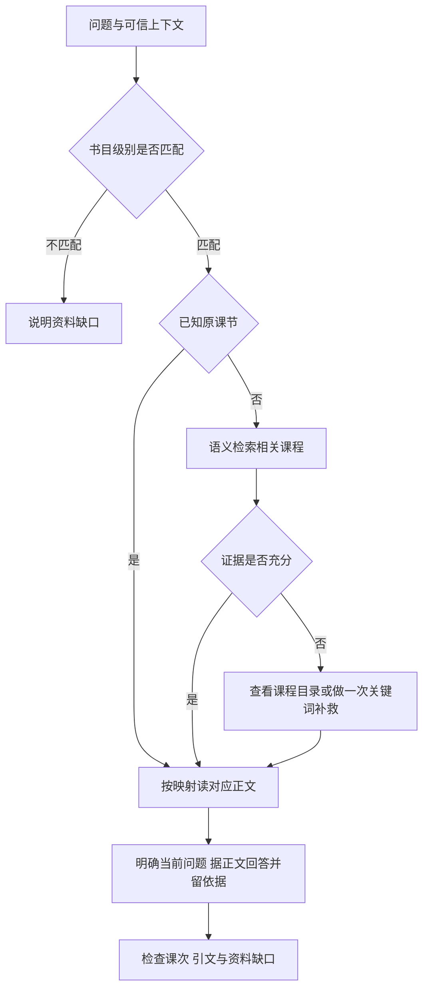

# OpenViking课程目录与回答对照实验

2026年10月3日。本轮保持“一课一份完整资料”的结构，对比整书语义检索与目录选课，再检查模型是否能根据正文回答。结果支持保留语义检索，把目录用于导航与补救；暂不建议所有问题都增加一次模型目录选课。

## 实验范围

课程为L2《了不起的狐狸爸爸》，仍使用`source-c764d8b325cc-nosplit-v2`。12道新题包含8道教学指导或具体情节题、4道资料边界题；另加入3道旧难例，单独统计。新题由实验者参考课纲编写，查询前冻结，不能称为独立业务测试集。

A方式是在整书范围执行带课程类型过滤的`find`，选前三个不同课次读取正文。B方式是模型看20课方法目录，选择最多3课再读正文。两组使用同一模型`qwen3.8-flash`、同一回答提示、同一适用范围与资料缺口说明；选课和回答时不提供评分要求或参考课次。已知原课次的模拟上下文双方均可见。

本次外部模型接口及发送范围已由用户明确授权，仅处理课程片段、模拟问题和生成答案，没有学生家庭真实记录。课程访问仍通过服务器OpenViking CLI。

## 对照结果

| 指标 | A 语义检索后读正文 | B 目录选课后读正文 |
| --- | --- | --- |
| 新教学题参考课节在前三课内 | 8/8 | 8/8 |
| 新教学题自动评分通过 | 6/8 | 7/8 |
| 新边界题自动评分通过 | 4/4 | 4/4 |
| 旧难例按证据标准重新评审通过 | 1/3 | 2/3 |
| 选资料阶段中位耗时 | 0.414秒 | 13.798秒 |
| 回答生成中位耗时 | 31.512秒 | 30.242秒 |
| 每题平均读取正文数 | 3 | 2.07 |
| 15题回答及选课模型总token | 92,244 | 123,107 |

模型用量不含评审调用，不含OpenViking内部嵌入用量，也不是实际计费金额。B少读了一些正文，但选课模型增加51,756个token，合计比A多约33.5%。正文读请求共享缓存，因此阶段耗时不能直接当作生产端到端耗时。

主实验30份答案提供51处引文，均能在各自实际读取的正文中逐字找到。然而自动评审漏判了部分问题：n09 B在没有《小王子》资料时仍提及该书内容；n12 A把“无法确认是原著原句”说成“不是原著原句”；部分回答错误要求用户补充已经提供的问题。因此表中的4/4不代表边界已经验收通过。复核意见见[逐题问题记录](../build/openviking/experiments/20261003-catalog/复核问题记录.md)。

A是单独检索路线的对照，不代表正式方案应在已知课次时仍先搜索。旧难例的新评审允许多种有据的教学指导来源，不能与旧版严格指定课次的分数直接比较；旧成绩不变。每题每组仅生成一次，选课相同也出现回答质量不同，不能把一题分差归因于目录优越。

## 已核实的发现

**目录没有显著增加这组新题的参考课节召回。** 8道有资料可回答的新题，两种方式均在前三课中包含预先列出的参考课节。前7道题的第一课也相同；已核对第7天的补课题，A把第7课排在第三位，B只选择第7课。已知课次应直接使用映射读取，无需为此增加一次模型选课。

**方法目录不覆盖全部情节细节。** “狐狸为什么迎着风走”需要第2课的逆风嗅闻情节，但B选择了第8、9、10课；A前三课也没有第2课，第2课位于第四条。单纯换成目录路线没有解决这一难例。后续探索使用关键词“逆风”检索，找到了第2课并完成正文答疑。这项是看到失败后的定向补救，不计入主成绩，也没有验证自动选择关键词的完整流程。

**模型输入组织影响答疑。** 多个初次回答声称“没有具体问题”，尽管请求JSON中存在`query`字段，且返回未被截断。已保留请求和失败答案。追加实验选择n02和n04两题，保持模型、系统提示和各组正文不变，把家长问题以自然语言在参考资料前后明确展示。四份复测回答均通过自动评分与逐字引用检查。这支持优先调整输入组织方式，但每项仅重复一次，尚未排除模型采样差异；不能归因于检索改进。

追加回答仍有需修正的表达：关键词补救答复将课纲中的剧情说明称为“原著情节”，并未实际核对原著；n04 B又在缺口字段索要补课日期。这说明输入格式改进解决了这几个样例的“没有提问”问题，但不等于答疑约束已经全部解决。

**参考资料齐全不保证回答完整。** 初次回答还出现泛泛复述课程、不必要列出所有资料缺口、要求用户重复提供已有问题等现象。后端应明确标示当前家长问题、可信服务上下文与参考正文，并要求围绕当前问题回答；引用与内部版本说明可以保留在内部依据中，不必每次挤占家长答复。

## 证据恢复与脚本修复

已下载服务器原有398份JSON文件，其中385条原始CLI回执。重新计算确认28份课程正文与生成文件、原稿对应内容一致，56份目录摘要与概览读回一致，四个导入任务均已完成。旧15题的类型过滤检索成绩仍为首位10题、前三课12题、前五课13题，未更改旧评分。

本次发现并修复`ops/course_cli.py`的解析错误：CLI在正式响应前回显查询，查询若含JSON上下文，旧解析器会把该上下文当成服务端结果。现仅解析输出末尾完整JSON，新增4个针对性测试通过。已经产生的错误解析回执未覆盖，另存可重算的解析纠正记录；未为此重复发送检索请求。

## 建议采用的简化取资料流程

目录保留在知识层，作为智能体能够读取的导航资源；不需要把它变成每次都必须执行的模型调用。关键词补救也应有次数和范围限制，未找到结果不能据此证明资料不存在。上述流程是接入建议，本轮没有绑定老师智能体、修改服务Skills或部署新的服务运行流程。

## 来源审核仍需保留

课纲原文第378行写有“骆驼靠驼峰储水”，与圣迭戈动物园关于驼峰储存脂肪的说明不符。[核查来源](https://animals.sandiegozoo.org/animals/camel)。问题已单独登记，原稿及云端正文未擅自改动。引用准确、读取完整与课程事实正确需要分别检查，技术测试通过不能取消来源未审核状态。

## 实验产物

- [完整实验目录及复跑方法](../build/openviking/experiments/20261003-catalog/README.md)
- [20课简明导航](../build/openviking/experiments/20261003-catalog/课程导航.md)
- [冻结问题与提示词](../build/openviking/experiments/20261003-catalog/frozen-inputs.json)
- [原始回执重新核验结果](../build/openviking/experiments/20261003-catalog/recovered-verification.json)
- [量化汇总](../build/openviking/experiments/20261003-catalog/summary.json)
- [主实验逐题回答及自动评审](../build/openviking/experiments/20261003-catalog/逐题回答与评审.md)
- [追加实验完整结果](../build/openviking/experiments/20261003-catalog/followup-results.json)
- [逐题复核意见](../build/openviking/experiments/20261003-catalog/复核问题记录.md)
- [来源质量待审核记录](../build/openviking/experiments/20261003-catalog/来源质量待审核.md)

正式业务使用前仍需要教研确认课纲内容、课程和书籍版本、真实班期课节映射，以及用真实脱敏问题做独立复测。本次数据仅支持这个级别、这本书的小样本技术判断。
