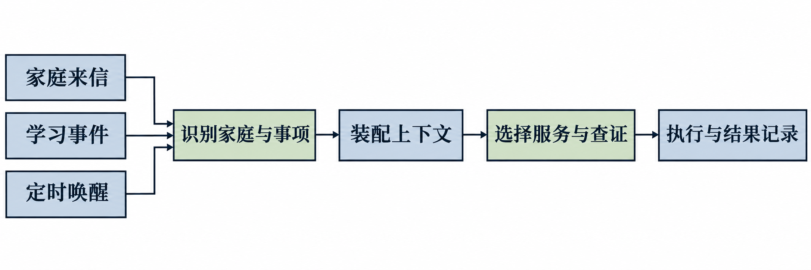

# 服务流程设计

数字阅读辅导服务围绕“事件触发、上下文准备、服务判断、执行交付和结果记录”展开。家庭消息、学习进展及定时检查分别触发相应处理，系统根据当前家庭的信息和服务要求，决定本轮需要完成的事项。下图展示服务流程的主要环节。

*数字阅读辅导服务流程。三类事件可分别触发服务处理；不同场景按实际需要选择资料查询、服务安排和交付方式。*

## 家庭来信处理

家庭来信处理承担日常咨询、阅读答疑和服务调整等任务。一次处理从识别家庭和当前说话者开始，结合近期对话确定问题，再根据问题性质选择服务方法、查询所需资料，最后完成回复或提交人工核实。

**第一，接收消息并识别上下文。** 系统将来信与对应家庭关联，读取本轮及近期相关对话，判断说话者是家长还是孩子，以及消息是否延续此前话题。家庭连续发送多条消息时，系统按照当前运行环境的消息合并策略组织为同一轮处理，减少因逐条理解而产生的语义割裂。若生成回复期间出现新的来信，系统需要重新检查已有回复是否仍适用。

**第二，识别服务需求。** 系统根据消息内容区分普通交流、阅读答疑、课程及产品咨询、学习困难、投诉反馈，以及对既有服务安排的调整。普通问候、致谢或简短确认，可以根据上下文直接回应。涉及阅读题目时，应先核对当前书目、课次、题目及家庭提出的问题。家长代孩子提问时，回复对象和解释方式需要与实际沟通场景相适应。

**第三，查询资料并形成答复。** 阅读答疑优先查找与题目对应的引读问答；家庭进一步询问原因时，再按需查阅相关课程正文。涉及课程安排、产品功能或操作问题时，查询相应业务资料并核对适用条件。检索结果为定位资料提供线索，形成确定答复前仍需核对实际资料内容。

**第四，处理信息不足或资料缺失。** 如果书名、课次或题目存在影响判断的歧义，系统提出必要的澄清问题。例如，书名简称可能对应两本书时，先列出候选书目，由家庭确认。问题已经明确但答复所需资料无法取得时，已设计的人工交接流程要求将原问题、已查情况及待核实内容提交老师处理。人工待办建立后，老师接单、完成答复和问题解决仍需分别确认。

**第五，发送并记录结果。** 系统按照回复规范组织文字或相关素材，并记录实际发送结果。普通答疑完成后，后续处理以家庭的新消息为依据；涉及已有安排的来信，则需要同步处理原事项，避免同一内容在之后再次触发。

| 家庭来信类型 | 主要处理依据 | 预期处理结果 |
| --- | --- | --- |
| 普通问候、致谢 | 当前消息及近期对话 | 结合语境简短回应 |
| 阅读作答与讲解 | 书目、课次、题目、来源答案及必要的课程正文 | 核对当前答案或解释具体问题 |
| 课程及产品咨询 | 问题范围、业务资料及其适用条件 | 提供有依据的说明，必要时转交核实 |
| 请假、暂停或调整安排 | 家庭原话、适用时间及已有事项 | 确认需求，并按实际情况处理相关安排 |
| 投诉或资料缺失 | 家庭描述、已查资料及可用的人工处理入口 | 记录具体问题并按流程交由老师核实 |

上述流程已在指定场景中开展模拟验证。真实试用中曾出现证据不足却作出否定判断、未触发人工交接的情况，相关判断仍需继续完善。

## 主动服务与事项管理

主动服务围绕课程安排、学习进展和已确定的服务规则开展。其主要流程包括发现服务机会、形成事项、到期复核、执行交付及结果回写。

**服务机会识别。** 系统根据课程计划、完课事件及当前家庭状态，判断是否存在需要处理的服务机会。例如，孩子完成课程后，可检查是否符合连续阅读鼓励或回归欢迎的条件；到达周度服务时间后，可结合本周应学与实际完成情况，判断是否需要发送总结或开展补读沟通。服务机会的判断需要考虑已有提醒、最近交流以及家庭明确提出的联系限制。

**形成服务事项。** 对符合条件的服务，系统记录服务对象、服务内容、触发依据、计划执行时间和有效窗口，并与对应的业务方法关联。事项形成后，可以随家庭新消息、学习进度变化或人工调整而更新。家庭要求暂停联系时，需要记录暂停范围及适用时间，并检查相关待执行事项。

**到期复核与执行。** 事项到达执行时间后，系统重新核对家庭状态、学习记录、暂停要求、有效窗口和既有交付记录。例如，一项补读提醒安排后，如果孩子已完成相应课次，原提醒需要重新判断；如果家庭已经要求暂停联系，相关事项应按暂停范围处理。针对同一事件或课次的重复触发，系统依据已有记录识别和控制重复服务。

**交付核对与状态更新。** 服务可能由文字、图片或文件共同组成。以周度总结为例，系统需要将总结与实际课程周对应，核对当周文件，再结合全部完成、部分完成或零完成等情况组织口信。文件和文字分别产生交付结果，相关结果得到确认后，才可记录该次服务的完成情况。交付失败或结果暂不明确时，保留相应状态，供后续核对与处理。

| 阶段 | 主要处理内容 | 记录或结果 |
| --- | --- | --- |
| 触发与判断 | 根据课程时间、学习事件及已有安排判断服务必要性 | 待处理的服务机会 |
| 事项形成 | 明确服务对象、依据、计划时间及适用窗口 | 可追踪的服务事项 |
| 执行前复核 | 检查最新学情、家庭要求、时间窗口及历史交付 | 继续执行、调整、暂缓或结束 |
| 服务交付 | 发送适用的文字、图片或文件 | 各项实际交付结果 |
| 结果回写 | 关联事项与交付结果，保留失败或未确认状态 | 可供后续服务查询的处理记录 |

完课相关的部分主动服务已开展 14 个模拟场景验证，覆盖正常交付、暂停、过期、去重及恢复。真实家庭的持续主动服务效果仍需后续验证。

## 上下文与家庭记忆

上下文用于支持当前一轮服务的判断，家庭记忆用于保存经整理后对后续服务仍有价值的信息。两者结合，使系统能够理解当前问题与此前沟通、学习进展及服务安排之间的关系。

**当前服务上下文。** 系统根据本轮任务组织相关信息，包括家庭身份、说话者、当前来信、近期对话、课程与学习记录、已有服务事项、近期交付结果及有效联系限制。不同信息保留各自来源和时间含义。例如，家长表示孩子已经读完，与学习记录显示课程完成，分别作为家庭陈述和系统记录使用；计划发送的周总结，与已经确认交付的周总结，也分别记录。

**按服务需要使用资料。** 系统根据当前问题选择相关信息。阅读作答需要定位原题及对应答案；补读沟通需要结合应学、已学和缺课情况；家长要求调整安排时，需要查看相关事项及原约定。当前家庭的最新表述对于理解本轮需求具有直接作用，历史信息应结合其来源和有效时间使用。

**家庭记忆的整理内容。** 家庭记忆设计关注称呼、明确表达的沟通偏好、相对稳定的家庭安排、需要延续处理的事项，以及家庭对既有信息的纠正。记忆内容需保留主体和证据，并区分家庭明确表达的信息、观察到的行为和需要进一步确认的判断。具有明确时限的内容应保留时限，例如“明天请假”适用于所指日期。

**更新、纠正与遗忘。** 当家庭对原有信息提出更正时，后续服务应依据新的表述调整判断，并按记忆维护规则处理旧记录。家庭明确要求删除信息时，按相应遗忘流程处理。周期性整理的设计包括读取新增服务记录、核对既有记忆、形成变更建议，并在复核后提交更新。

| 信息类型 | 主要内容 | 使用要求 |
| --- | --- | --- |
| 近期对话 | 当前来信、上下文原话及近期沟通 | 确认说话对象、话题和最新要求 |
| 学习信息 | 课表、应学课次、完课及缺课记录 | 按实际时间和来源判断学习进展 |
| 服务信息 | 待执行事项、暂停要求及交付记录 | 确认已有安排，避免重复联系 |
| 家庭记忆 | 称呼、明确偏好、持续约定及历史纠正 | 结合证据、主体和有效期使用 |

项目已有家庭记忆规则及相关程序基础，并对请假等信息进入后续规划开展了模拟验证。跨周期整理、长期服务方案调整及后续使用的完整闭环仍需进一步验收。
