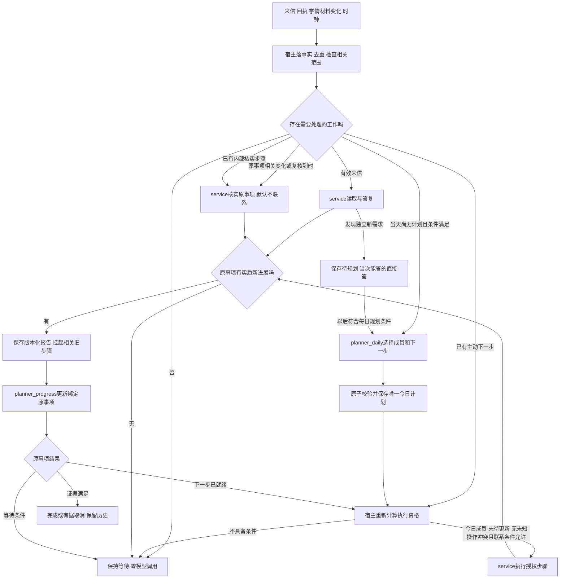

# 持续教辅服务工作流与触发边界讨论稿

> 日内承接方向更新（2026-10-05）：用户已选择第5节第二种，支持日内正式承接，并明确Planner规划、Service执行、按时间安排。本文V0.1保留为上一轮分析；其中“尚待选择”和“次日才可新增”的未来方向由[日内承接与按时执行设计](日内承接与按时执行设计.md)接续。已实现与验收状态不因此改变。

2026-10-05 · 讨论稿V0.1。基于已批准的两个角色、三个上下文配方、每日唯一正式计划和原事项progress合同。本文说明推荐工作流与待取舍边界，不表示已实现或新合同已批准；本轮不改代码、不运行模型、不启常驻服务。

## 1. 持续的是什么

持续存在的是家庭服务关系、未履行的责任、原始事实与恢复条件；单个事项有可验证的终点，单次模型运行有明确边界。家庭今天暂时无事可做，不代表结束服务；未完成事项也不要求模型一直运行。

| 层次 | 职责 | 不能混淆的状态 |
| --- | --- | --- |
| 家庭与责任目录 | 保存所有未完成目标、交付、未答、待规划和暂停 | 事项没进今天清单，不等于删除责任 |
| DailyPlan | 为今天确定主动推进成员和优先顺序 | 进入清单不等于现在可以联系，也不代表必须联系 |
| Event与当前下一步 | 保存原完成条件、当前动作或等待条件、依据及期限 | 一个动作完成不等于整个目标完成 |
| Report / progress | 将本轮新事实核实后应用到绑定原事项 | 报告已保存不等于修改已生效，省略判断不等于全部完成 |
| 持久Job与一次Hermes运行 | 可靠领取、有限处理、可恢复、记录结果 | Job结束不等于Event结束；Job等待不长期占用家庭执行权 |

原生plan/todo用于一次运行内组织工作。业务目录、每日主动资格和实际交付账不能交给模型TODO自由勾选。继续用已有SQLite、Scheduler、Worker、JobQueue与Hermes AIAgent，不新增通用工作流引擎。

## 2. 完整工作流

图中的箭头表示有条件的事件流，不是让模型持续自调用。数据库写入、审计、心跳、相同状态再次查询，不构成新的业务进展。未来等待不得用循环sleep占住一个模型run。

### 每日开始

08:00由宿主触发本家庭当天尚未成功的daily任务。先处理已有来信及可消费报告；已知未消费报告在进入daily模型前挡住。消化报告后若当天仍无计划、仍在允许运行窗口，原daily任务以新快照恢复；不清空报告，不另开第二个规划入口。

daily读取全部未完责任、待规划、可信候选、来源覆盖、家庭偏好和约束，决定：沿用什么、新建什么、今天推进谁、哪些暂缓。旧责任继续存在。对最终今日成员，后端必须验证有合法下一步或明确等待；原子提交成功才取得今日主动范围。失败载荷不占当天成功名额。

一天只成功提交一次，不要求恰好08:00已经成功，更不表示8点统一向所有家庭发消息。来源未确认时不造候选，真实学情迟到不自动建立当天第二份计划。

### 白天即时答疑

有效来信直接唤醒service，不等待Planner。读取本次授权原消息和必要知识/学情，处理多意图、明确暂停、记忆更正及问题答复。暂停立即生效，不先等progress。普通问答没有原事项进展时，不调用Planner。

service可以回应未在今日清单中的旧事项；如果形成原事项新事实，可以提交该事项报告。progress可更新这个原事项，但不得因此把它加入今天主动范围。

来信使同家庭旧运行的执行依据失效时，撤销旧能力并等待原进程退出/租约安全释放，再优先处理来信；旧任务随后使用新快照恢复。已经发起的外部操作保留事实，先查原operation，不假装撤回，也不重新发一遍。

### 主动推进

宿主对已提交事项作确定性检查：今天是否有主动资格、是否处于可执行状态、是否有新来信/未消费报告、暂停与联系限制是否允许、是否已有相同操作或未知发送、此刻是否在有效窗口。能判断为无工作或被限制时，尽量不进入模型。

满足条件后，用一次有限service运行处理当前授权任务。一次任务可包含多个读取和工具动作，但不扩大原目标或变成跨日驻留模型。完成本轮动作后记录实际回执/核实事实；有原事项进展才报告，由progress决定下一步、等待或完成。

下一步可以是内部核实，也可以是获准的服务动作。不要求daily预先写死所有后续步骤，后续方法由真实反馈决定。家长完成学习之前，提醒成功只算已执行提醒。

### 等待与恢复

等待必须回答三个问题：在等什么、什么证据能解除、由哪个现有输入入口核实。自由文字“以后再看看”不足以实现自动恢复。

| 等待原因 | 可以核实的恢复依据 | 未发生变化时 |
| --- | --- | --- |
| 等家长回复 | 关联新来信，service理解后报告 | 不把没有回复当作新的催促授权 |
| 等真实学情 | 原课节相关可信来源内容/覆盖更新，核验后报告 | 不反复让模型查同一快照 |
| 等发送结果 | 原operation阶段确实变化 | 有界查原操作，不新发、不伪报成功 |
| 等批准材料 | 原失败读取对应材料恢复，重新读取 | 有界探测不改家庭业务版本 |
| 等约定时点 | 有来源的时间或明确内部review_at | 到点先核实，不自动解除暂停 |
| 技术失败 | 有界退避重试或人工明确恢复 | 超限保留失败及责任，不无限重试 |

源导入/回执先由程序落事实并定位相关原事项。需要业务解释时走原service/review→报告→progress；没有实质变化不报空进展。完成证据更正定位原已完成事项，受限复核原ID，不新增独立Planner入口。

waiting没有review_at仍保留在全量责任目录；若确有对应外部触发则等待它，次日daily也会看到。对“既无可识别外部恢复依据又无复核安排”的情况要显式暴露待处理缺口，不能宣称已经配置自动恢复。

### 晚间与跨日

北京时间21:00停止常规新外发，普通回复同样受限；执行到发送时重新检查实际进程时钟。后台仍可接收消息/回执、保存事实，处理允许的内部核实及报告更新。K现有夜间领取豁免限review、progress及原内部恢复；普通service并非都能夜间运行，一般来源核实触发仍待4D接线。消息不丢，未答保留。

次日保留原Event、原期限、有效暂停、未消费报告和未知operation，过期的是旧日主动资格、绑定旧业务日的主动步骤任务及旧运行能力；未答回复、报告progress与未知operation恢复等持久任务沿原身份继续，不因换日失效。下一次daily重新决定今日成员，不能机械复制昨日主动名单或批量补发。

## 3. 多事项、多家庭与公平推进

同家庭多个事项可以同时未完成；一项等待时释放执行权，另一项可按自己的条件推进。家庭内执行串行保证消息/暂停/回执一致，家庭之间可在现有Worker容量内并行，实例与材料上下文隔离。主动触达限制按家庭统筹，不能每个事项各算一份额度。

优先级基线仍为来信→progress→daily→review→step。还应验证持续来信下旧报告、已承诺交付是否长期饥饿；若需公平性修正，在原队列选择策略内做有界轮转/等待时长检查，不能通过越过未处理来信的发送门禁解决。具体阈值尚未批准，不在本稿硬编码。

报告update_pending主要阻止关联事项重复执行；已经存在今日计划时，不应无故停止其他无关事项或普通答疑。未消费报告阻止新的daily是现有家庭级门禁：单个报告长期失败会阻塞该家庭下一次daily，需有可见原因及受限修订/重试路径。不能假装已消费，也不能让技术失败把责任悄悄消失。现阶段不声称已有自动人工接续服务。

## 4. 两日示例

示例仅用于核对职责，不指定正式模型答案、联系频率或正式学情阈值。

| 时点 | 家庭A：补读目标E1、文字反馈交付E2 | 状态含义 |
| --- | --- | --- |
| 第一天08:00 | daily确认可信候选，创建/沿用E1和E2，给出当前动作 | 两项各有完成条件，尚未交付 |
| 适合联系时 | service发送合规的E1提醒，取得实际回执 | 提醒已发，补读没完成 |
| 报告被消费 | progress令E1等待相关学情/家长进展，保留原目标 | Worker释放，E2可继续 |
| 随后 | service生成并发送E2所需文字，核实际回执后报告 | progress满足原合同才完成E2 |
| 家长来信 | 说只读一部分，同时问一个课程问题 | service先答问题、记录部分进展；E1不结案 |
| 新学情 | 可信来源确认原目标范围实际完成，证据有效 | 程序定位E1；必要核实形成报告，progress满足原completion后完成；仅补齐覆盖不算完成 |
| 21:10来信 | 新问题入库但不常规外发 | 未答保留，不能因过日清除 |
| 次日08:00 | 先处理可处理来信和旧报告；daily恢复全部责任 | E2/E1若已完成不重复；未完成者沿原ID再取舍 |

如果第一天一直没有学情变化或家长回复，E1可以保持等待，系统不用持续花模型调用追问它。家庭B的任务继续按自己的状态运行。

## 5. 必须明确的日内接单边界

当前合同：“只有daily新增正式事项并确定当天主动成员；progress只更新绑定原事项。”这是一项业务能力限制，不能被Goal/TODO或宿主定时器绕过。

| 家长请求 | 当前合同下处理 |
| --- | --- |
| “现在解释一下这一题”或现在就能基于可靠资料完成的文字答复 | service当次直接完成，按消息意图与真实回复记账 |
| “原本约好的这份反馈改到下午” | 核是否属于同一个原事项及有效改约，经报告/progress；主动发送仍核今日资格/暂停/窗口 |
| “今天下午4点给我新增发一份总结” | 保存独立新需求与原期限，不承诺已安排；次日daily不能冒充按时履约 |
| “明天下午4点前给我一份阅读总结”且当前没有事项 | 登记原期望；次日daily可决定，但登记时不能保证一定接纳/按期交付 |

“稍后通知您安排结果”“到时再联系”本身也是未来主动义务，pending登记不能授权这类承诺。登记意图处理完可以正常结清，不能故意留一条未答消息作为未来定时外发凭证。接受补读服务安排也不等于保证家庭届时实际完成学习。

两种产品选择需区分：

- **保留当前日批新增边界**：先把现有事项持续推进链验清；当次可回答的照常回答，新后续服务明确待安排。实现范围稳定，但不能提供“当天随时确认新增定时服务”。
- **要求当天随时接下新后续服务**：需另行明确受控日内接单和主动资格增补规则，包括谁接纳、承诺何时生效、如何避免重复/过载/绕过暂停。可以保留两个角色，但必须调整每日唯一成员合同；不是普通bug修复，本稿未采用或实施。

建议先由用户确认这项产品预期，再决定是否调整主合同。若保留当前边界，三个已定位工程修复可以继续；若需日内接单，应先把具体接纳合同补清，避免在4D实现后返工。

## 6. 本稿与当前实现的差距

当前已有：SQLite责任与单一持久队列、家庭租约串行、服务/规划能力范围、每日唯一提交、发送门禁、新输入让行、部分未知发送及材料恢复、原生Hermes有限运行。passive/daily/full是阶段启用开关，不是新的角色；完整持续链需要在隔离mock的full模式验收，不能把daily模式阻止progress当成调度死锁。

已定位待修复：今日成员缺执行入口；报告缺省值混淆；回执派生版本阻止原报告消费。

仍需4D闭环证明或补齐：一般等待的相关来源/恢复条件匹配、无变化判重、原步骤→报告→progress→下一步、可信更正恢复、跨日资格与承诺、多个事项公平推进、报告长期失败可诊断恢复。当前一般waiting仍有按家庭版本唤醒的宽泛分支，不能宣称已做到所有来源精确订阅；材料专用恢复也不是通用事件系统。当前plan.rank尚未参与队列选择，故今日排序字段不能当执行顺序已生效；Hermes cron唤醒的配置还需与Worker统一可信mode、strict和业务钟。上述均需补验，不能按设计文字宣称已有保证。

验收应覆盖多事项交错，而不只跑一个Goal：E1等待时E2成功；来信插入旧步骤；同源重复/无关字段变化零新增模型；回执未知不重发；报告失败不丢责任；21点前生成而21点后发送被挡；次日沿用而不批量重发；未入选旧事项收到来信仍可答；日内新需求不能偷偷进入主动范围。

相关前置分析：[工程根因与原生Plan借鉴](第四阶段计划与进展合同问题排查及原生Plan机制借鉴.md)。本稿三路复核材料位于 `work/stage4/continuous-workflow-20261005/`。
