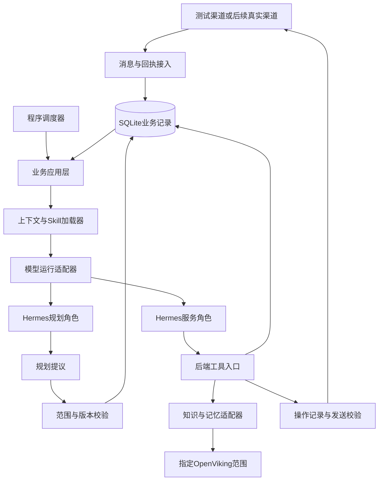

# 教辅后端实施细化草案

版本：细化稿 V0.2。日期：2026年10月3日，Asia/Shanghai。运行架构与完整服务链路已获用户接受；新增接口细节仍可修改，后端尚未实现。

本文供项目负责人逐项修改，将简化版V1细化为可开发、可验证的运行架构和实施合同。建议采用单个Python业务后端管理状态、调度与对外操作，由Hermes承载隔离的模型角色，通过受控适配器使用知识与记忆。Hermes集成方式需要先做能力验证，本文不宣称接口已经接通。

依据：[总体方案](教辅数字员工智能体后端开发方案.md)、[运行机制](规划与执行运行机制设计.md)、[上下文设计](双智能体上下文组装设计.md)、[工程与验收](智能体后端工程与验收设计.md)。用户已接受本稿运行方向并要求继续推进；框架能力和未知业务规则仍待验证，不因设计接受而视为接通。新增细节见[数据与接口合同](教辅后端数据与接口合同.md)、[开发任务清单](教辅后端开发任务清单.md)和[实际输入对齐](教辅输入对齐与学情映射.md)。

## 本轮决定与评审重点

用户已选择主动联系与普通答复统一截止，并授权补充具体时间。本稿将晚间截止T设为北京时间21:00，作为可配置默认值。21:00起停止新的常规对外发送，接收、回执入账、核实和内部状态更新继续进行。

当前设计默认服务窗口为每日08:00至21:00，包含08:00、不包含21:00。08:00为来信回复窗口开启和daily规划触发时间，主动联系还需满足家庭偏好与具体步骤的允许时间。窗口作为配置维护，尚未部署。

本轮已接受的运行方向：

1. 业务后端掌握持久状态、调度和发送权限，Hermes负责有界的模型运行。
2. 家庭对话在产品上连续，每次模型运行按职责重新装配上下文，业务责任从数据库恢复。
3. 首条闭环采用一个虚构家庭、文字渠道、补课目标和反馈交付；真实渠道在故障验证后接入。
4. 先验证Hermes的角色隔离与工具接入，再冻结模型适配器实现，避免把未核实的框架能力写成前提。

## 现有基础和需要补齐的部分

本轮只读核对本地文件，未连接远端。以下远端描述来自2026年10月3日交接记录，不代表本轮重新验证了服务状态。

| 依据 | 已有内容 | 对实施的影响 |
| --- | --- | --- |
| [服务器交接](远程服务器与Git交接.md) | Hermes固定版本、headless入口、OpenViking独立环境和部署记录 | 先检查固定版本能力，不先升级或更换框架 |
| [Skills交接](服务Skills开发总结与后续会话交接.md) | 41个Skill目录、6份共用规范、配置样例；记录显示未绑定业务加载 | 文件齐备与运行加载分别验收 |
| [规划Skill](../agent/skills/plan-proactive-service/SKILL.md) | 仍描述多种触发候选和状态规划 | 接入前适配daily/progress权限，不能原样当成V1执行合同 |
| [收尾Skill](../agent/skills/close-service-case/SKILL.md) | 含关闭子任务、写回事项等表述 | 改为整理真实结果和进展建议，实际结案由Planner与后端完成 |
| [规则配置](../agent/config/service.yaml) | 自动触发关闭，缺课、频控、人工等口径有待确认项 | 待确认规则只产出缺口，不启用对应自动候选 |
| [课程知识记录](OpenViking课程知识优化与测试.md)与[产品知识记录](OpenViking产品知识接入与维护.md) | 正文、映射和历史读取证据 | 需要将知识映射接入业务工具，并保留来源适用范围 |

现有Hermes内置记忆连接本地OpenViking；课程与产品记录使用企业版配置。实施时分别配置知识连接和个性化记忆连接，不假定同一个端点包含全部资料。首版家庭记忆采用哪个实际存储范围需验证，不能把开发账号当作家庭隔离方案。

## 运行架构

### 组件和权责

拟新增一个业务应用进程，内部包含接入、调度、上下文、状态提交和操作执行模块。Hermes与OpenViking保留既有独立运行环境；“单Python应用”指新增业务后端，不表示把三个组件装进同一环境或进程。

| 组件 | 负责 | 权限边界 |
| --- | --- | --- |
| 业务应用层 | 绑定家庭身份、分派运行、校验提议、形成提交结果 | 数据库中的有效状态由此维护 |
| 调度器 | daily到时、原步骤领取、报告恢复、回执核实、窗口与跨日扫描 | 扫描本身不调用Planner；不能新增正式目标 |
| 上下文与Skill加载器 | 三个上下文配方、必读规范、证据范围、版本清单 | 材料不全时报告缺口，不伪装加载完成 |
| Hermes运行适配器 | 启动隔离的服务或规划运行，接收工具调用与结果 | 不直接写业务数据库，不绕过后端发送 |
| 知识与记忆适配器 | 课程映射、限定范围检索、正文读取、个性化证据同步 | 公共知识与家庭记录分别限定范围 |
| 渠道适配器 | 接收入站消息，发送指定内容，查询原操作，归一化回执 | 不判断补课完成，不自行重发未知操作 |

这里的开发主控是协作职责：维护决定、拆解任务、检查集成和验收。产品运行时仍只有服务与Planner两个模型角色，不新增第三个“主控模型”。

### Hermes接入先验证的能力

优先复用固定版本Hermes。现有CLI与WebSocket部署记录仅作探测入口，尚不确定哪个接口能完整满足下表；具体接口、调用参数和钩子以固定版本源码及隔离验证为准。

| 验证项 | 通过证据 | 不满足时的处理 |
| --- | --- | --- |
| 角色隔离 | 两角色独立提示词、历史和工具集；交叉读取与越权调用被拒绝 | 隔离会话或运行环境后重试；不共享一个无限增长的对话 |
| 工具受控 | 只能经后端查询、报告和申请操作，开发运维/任意执行工具不向业务角色开放 | 验证可配置的工具注册或受控桥接，不能仅提示“不要调用” |
| 可观测运行 | 能关联run_id、工具请求、执行结果和最终输出，并区分失败与正常结束 | 补齐适配层记录；不能从一段文本推测调用成功 |
| 有界停止 | 超时、取消或旧运行失效后不能继续取得新操作资格 | 后端撤销run授权和租约，晚到输出仅留审计 |
| 上下文可控 | 本轮必需约束和Skill全文确实装入；自动记忆不混入其他家庭或规划推理 | 调整或关闭不受控注入，重新验证 |

适配器验证失败不会阻塞纯业务状态开发，可继续使用测试运行器。若固定版本确实无法满足，再提出具体替代方案供评审，不在未验证前维护两套生产运行路线。

### 模型运行和会话

拟用`AgentRun`表示一次有界运行，保存`run_id`、角色、配方、任务身份、输入版本、工具权限、提示词/Skill版本及终止原因。`service`区分`dialogue_reply`与`planned_service`；Planner区分`daily`与`progress`。

家长看到的是同一位老师和连续对话。底层优先采用每次任务可独立恢复的模型运行，近期真实聊天由后端装配；不依赖某个Hermes会话一直存活。家庭隔离和角色隔离必须同时成立，Planner推理不得进入家庭聊天历史。

模型调用在数据库事务外运行。每次具有副作用的工具调用重新检查run授权和当前业务状态，不能只验证运行启动时的一次快照。

## 服务窗口和调度

### 每日时间安排

| 时间或条件 | 内部工作 | 对外工作 |
| --- | --- | --- |
| 08:00前 | 收消息、回执和原操作查询，保存待处理责任 | 不发送常规消息 |
| 08:00 | 领取当前业务日唯一daily任务；处理隔夜未答输入 | 窗口允许的来信答复可独立进行，不等待daily |
| 08:00至21:00 | 执行原步骤、报告更新、知识查询、等待复核 | 每次发送再检查家庭偏好、暂停、频控、输入版本和实际时间 |
| 20:30 | 建议内部扫描一次临近承诺，识别未完成和未知操作 | 扫描不直接产生提醒，也不无条件调用Planner |
| 21:00起 | 停止领取新的常规外发步骤；继续入库、核实和处理报告 | 拦截尚未发起的发送；已发起操作等待真实结果 |

20:30为内部扫描建议，可配置，不是对客承诺。没有真实人工接续时，不宣称夜间已有真人受理；已接入的必要即时人工受理沿用其独立规则，不因此扩大普通服务窗口。

隔夜未答消息在下一窗口优先恢复，发送前重新阅读后续消息与当前状态。普通咨询无需等daily成功，主动服务必须持有当前业务日有效清单成员资格。daily失败时保留旧责任，但昨天的清单不自动授权今天主动联系。

### 程序队列

首版建议使用数据库任务表和轮询扫描，不额外引入外部消息队列。消息入库、报告提交和待执行任务登记在同一短事务完成，避免进程中断后出现“有报告、无处理任务”。重复扫描依靠任务身份去重。

同一家庭首版最多一个服务模型运行，避免主动服务与答复同时形成冲突文案。新来信持久化后使相关旧主动草稿失效，服务运行在受控边界停止或重评；消息接入、暂停控制、操作核实不被该模型锁阻塞。Planner可独立运行，最终提交仍检查版本。

调度先处理当前来信和已生效控制，再安排原事项的必要核验与主动步骤。这里只调整当前可领取任务，不由程序改写每日事项排序。旧事项不在今日清单时，来信可引发其进展更新，更新不会自动授予主动联系资格。

等待唤醒分两步：程序先标记“可核验”，服务核验原步骤并报告实际变化；需要时progress再更新Event。`waiting`不能仅因计时器到点就直接发消息。无变化核验只保存检查时间和下一次检查依据，不创建空报告。

`update_pending`阻止同事项重复主动派发，仍允许处理报告、补齐证据、查询原操作和必要澄清，避免“等待更新却无法取得更新证据”的互锁。缺少证据可提交明确的等待结果并精确消费报告；处理失败则保留待更新责任。

## 数据合同

### 身份和版本

家庭、学生、课程和渠道身份由后端映射，模型不能以工具参数切换家庭。首版服务一个家庭，但所有业务读写仍带`family_id`；`uid`是学情主体，不能当作家长收件地址。

建议保留三类版本：业务记录`version`用于并发检查；`requirement_revision`标记要求的实质变化；证据的`source_revision`标记原资料版本。期限变化和内容更正分别判定影响，不能因普通版本递增机械作废所有已交付内容。

### 首版记录

| 记录 | 本稿建议补足的字段 | 主要用途 |
| --- | --- | --- |
| FamilyBinding | family_id、uid、channel_recipient_ref、timezone、偏好与来源 | 明确学情和实际收件对象 |
| LearningSnapshot | snapshot_id、source、source_revision、retrieved_at、coverage_through、各课程事实及缺口 | 区分取得数据时间与事实覆盖时间 |
| ServiceEvent | 稳定目标范围、goal_key、completion_kind/rule、状态、剩余工作、期限、等待、version | 跨日持续责任；按结构化目标查重 |
| DailyPlan与条目 | family_id、business_date、daily_run_id、成员、顺序、动作窗口、结果 | 固定当日主动范围；每家庭每日一份有效提交 |
| ServiceProgressReport | report_id、revision、event_ids、事实和建议、证据、操作、输入覆盖 | 独立保存原版本及其消费结果 |
| PendingPlanningInput | 来源、提出时间、原要求期限、已做/未做、消费决定和关联Event | 独立新后续需求不丢失、不提前变正式事项 |
| Control | 对象及动作范围、生效/解除依据、恢复条件、version | 暂停立即影响发送，不等Planner |
| Operation与Receipt | 操作ID、最终内容、收件人、要求版本、交付部分、阶段、外部ID、原回执 | 重启核实、部分交付、去重与迟到结果 |
| Message与Coverage | 渠道消息身份、原文/媒体引用、意图片段、已理解/已答/待跟进关系 | 防止多问题消息被一条答复整体清空 |
| AgentRun与Job | 配方、输入清单、任务键、尝试号、租约、重试原因与时间 | 模型及进程失败后恢复原任务 |
| CommitReceipt与MemorySync | 提议摘要、精确消费版本、提交结果；待同步证据版本 | 核实“已生效”，恢复记忆同步缺口 |

这些是逻辑记录，落库时可合并部分表；不要求建立通用流程引擎。租约另存，不把“工作进程正在运行”写成业务完成。

`goal_key`建议按家庭、目标类型、原课节或目标周期、适用要求组成，不包括模型文案、Skill别名、扫描时间和规则版本。补课课节集合按规范化范围生成；发生部分重叠时由daily判断原目标关联，不能只靠哈希认定两个目标独立或相同。

daily同目标合并优先选一个原Event继续，另存旧ID到保留ID的关联。源Event及历史不可删除，合并本身不算完成或取消；运行查询解析至保留ID，确保一套执行责任。不同完成标准不得合并。

### 完成规则

建议把首批完成标准限制为少量可校验类型，不接受模型任意可执行表达式。

| 类型 | 必需输入 | 完成条件 |
| --- | --- | --- |
| 指定课节补课目标 | 原课节集合、适用数据来源、有效版本 | 每个目标课节有适用的可靠完课证据；缺数据不能推断未完成或已完成 |
| 文字反馈交付 | 收件对象、反馈范围、必要部分、要求版本、指定交付阶段 | 每个必要部分都达到该事项约定且渠道确能证明的阶段 |
| 当次普通答疑 | 消息意图片段、实际答复与未解决内容 | 记录已回应范围；不必创建Event，不由发送成功推断问题完全解决 |

`delivery`的阶段可为渠道确认已发送或已送达，但必须在建立事项时明确。没有送达能力的渠道不能伪造送达，也不能运行中悄悄降低原标准。Planner提出完成，后端按规则与证据再次检查。

`goal`完成后如收到权威撤销，应先使相关执行资格失效并保留历史；针对原Event形成更正报告，允许有依据地重开原责任。重开不是白天新增目标，也不自动进入今日主动清单。

### 消息覆盖和新需求

消息入库即保存原始身份和序号；模型可提出意图片段及关联事项，后端保存覆盖关系。处理过的片段、已对外答复的片段、仍需核实的片段分别记录。模型输出草稿不等于已答，实际发出后才登记相应答复覆盖，交付阶段另外保存。

一条“孩子病了，先别催，课程入口在哪里”至少包含暂停与入口问题。暂停的保存不能自动将入口问题标为已答。独立新后续需求须写入PendingPlanningInput，并保留用户原期限和当次已做内容；记录待规划不等于已处理完原咨询。

## 模型输出与后端工具

以下为本项目拟议接口，不是已验证的Hermes原生API。首版优先使用进程内应用接口，模型桥接只暴露受控工具，不为每项能力新增HTTP服务。

| 调用者 | 拟议输入或输出 | 后端处理 |
| --- | --- | --- |
| 服务角色 | `read_event`、`read_learning`、`read_messages`、`read_operation` | 查询绑定家庭内的当前状态和证据 |
| 服务角色 | `load_skill`、`read_lesson`、`search_knowledge`、`read_knowledge` | 必读规范与正文按确定范围加载，返回来源版本和读取范围 |
| 服务角色 | `apply_control` | 保存有来源的暂停或其他明确支持的控制，返回提交结果 |
| 服务角色 | `record_pending_planning`、`submit_service_progress` | 持久化新需求或原事项报告，不能直接改正式目标 |
| 服务角色 | `prepare_operation`、`request_dispatch`、`query_commit` | 固化最终内容、执行发送校验，返回真实操作或提交阶段 |
| daily规划角色 | DailyProposal | 旧事项决定、必要新增、同目标合并、今日成员与顺序、输入消费范围 |
| progress规划角色 | ProgressProposal | 允许event_ids内的逐项更新、依据、剩余工作、下一步或等待 |

工具返回统一包含请求身份、成功或拒绝原因、实际结果、记录版本及证据引用。报告提交成功只表示报告已持久化；progress提交成功才表示事项更新生效。服务需要说“新期限已生效”时查询后者。

规划输出统一先做结构校验，再做范围、版本、证据和业务规则检查。不得提交任意SQL、文件路径修改或整条记录覆盖。更新采用字段白名单；白天不允许改变目标身份、降低完成标准、增加今日成员或整体重排。

语义限制不能完全靠字段名解决。首版限定动作类型、目标对象和完成规则；`next_action`除文字说明外须绑定动作类型与原目标范围。模型不能靠在说明里夹带新服务绕过结构检查，相关用例需真实模型语义验收。

建议将Hermes运行预算、最大工具步数和重试次数作为技术配置。初始测试可设每次模型运行120秒、最多8次工具调用、自动重试最多2次；这些是调试起点，不是服务承诺。冲突需读取新状态后重评，不能盲重放旧提议。

## 一条完整服务链路

以下时间、课节、家庭和学情均为测试夹具，不代表真实学员、缺课阈值或已批准触发规则。反馈示例指测试用文字学习反馈，不替代现有月度图文报告的格式要求。

| 步骤 | 输入和动作 | 持久结果与检查 |
| --- | --- | --- |
| 第一天08:00 | 测试学情给出明确待补的原课节，daily建立E1补课目标与E2文字反馈 | E1保存课节完成标准；E2保存内容范围、对象和交付阶段；计划成员固定 |
| 允许联系时 | 服务领取E2，加载反馈规范及适用证据，生成文字并申请发送 | O1先记录再发起；真实回执入账；服务报告E2；progress核实后完成E2 |
| 家长来信 | “孩子生病了，先别催。课程入口在哪？” | M1保存两个意图；服务先保存催课暂停C1，再读取实际入口资料并答复 |
| 报告进展 | 服务报告E1病情与暂停依据，建议等待 | R1持久化后E1待更新；progress改为waiting，保存恢复条件；失败也不撤销C1 |
| 同日下午 | 家长提出一个需要后续准备的独立学习安排需求 | 回应当前能回答部分；P1记录原要求、已做/未做；不修改E1目标来容纳新需求 |
| 21:00 | 尚未发起的常规发送被拦截 | 未答消息、E1、P1、未处理报告与未知操作继续保存 |
| 第二天08:00 | daily恢复E1和P1，读取最新可靠学情 | E1保留ID和暂停；E2不再派发；P1新增/关联/不采用有明确结果 |
| 后续学情 | 原课节出现可靠完成证据，原事项核验获得新事实 | 报告关联E1；progress按原目标完成；不会由“补课完成”自动解除其他适用暂停 |

其中入口答疑不等待progress。E2反馈发出也不关闭E1。家长一天不回复不会自动产生再次催促资格；等待事项不占执行位置。

## 提交并发和故障恢复

### 持久提交的顺序

daily和progress都在事务外获取上下文并生成提议。首版建议每家庭维护一个保守的相关输入版本，消息、控制、报告和要求更正等变化使旧提议需要重评；回执重复投递或工作租约心跳不无意义地改变该版本。

提交在短事务内检查任务身份、当前版本和允许范围，原子保存Event、计划条目、精确消费的报告/需求及CommitReceipt。出现版本冲突，保留旧提议和失败原因，重新读取；达到重试上限进入可见的待处理状态，不自动解除暂停或完成事项。

daily读取的未消费报告应选择“先progress提交”或“明确吸收到daily提议”之一。建议首版优先处理已就绪progress，仍未处理的报告由daily逐条声明吸收或保留；保留则相关事项继续待更新。较晚到达报告不被顺带消费，daily不能无限等待持续来信才允许结束。

同一report_id/revision和daily业务任务重复提交返回原结果；同身份不同载荷拒绝。旧报告处理完成只消费它覆盖的版本，有更新报告时不得清除待更新。report修订保留前一版与替代关系，不覆盖历史载荷。

### 操作的真实阶段

建议Operation区分`prepared`、`dispatching`、`accepted`、`sent`、`delivered`、`failed`、`unknown`、`cancelled`，另存渠道能力和原始回执。并非每个渠道都有全部阶段，`unknown`是需要核实的状态，不是失败证明。回执按证据与渠道顺序合并，已确认结果不能被迟到的unknown降级。

发送采用以下顺序：

1. 固化最终内容、收件人、交付部分和要求版本，建立稳定operation_id及去重依据。
2. 短事务重新检查窗口、暂停、新输入、事项/计划资格、频控和原操作；领取发送资格并记录租约。
3. 适配器发起请求前再次检查当前时间及有效授权，记录发送尝试；外部请求不持有数据库长事务。
4. 保存实际响应与回执，再补齐原服务报告；中断恢复优先查询原操作。

外部渠道与本地数据库之间无法仅靠短事务保证绝无临界竞态。最后检查后到网络发起之间若收到暂停，应尽可能撤销尚未发起请求；已经发起则保留真实事实，不声称撤回。验收记录控制提交、最后检查、请求发起的顺序，明确渠道可取消与不可取消的边界。

渠道支持幂等键时，原操作恢复沿用同一个键；是否可重试必须服从已验证的渠道语义。无幂等或查询能力的渠道，在结果未知时进入人工核实，不通过换ID重发来追求自动恢复。单次not_found不足以解除未知。

每个主动步骤使用稳定执行身份；纯文案改写或重新生成草稿不获得第二次发送机会。多个Event合用一条消息时，Operation保存逐事项交付部分，Planner分别判断完成。

### 故障后的责任

| 故障 | 恢复行为 |
| --- | --- |
| 模型超时或无效输出 | 保存原输入和失败，有限重试；没有操作就不制造交付记录 |
| 报告写入后进程退出 | 数据库任务恢复相同report_id/revision，原事项继续待更新 |
| 发送前进程退出 | 过期租约可回收，重新检查资格；已进入可能发起阶段则先核实 |
| 已发送但收尾未完成 | 根据原Operation和回执补齐报告，不再发送 |
| progress期间出现暂停或更正 | 旧提交冲突重评，已保存控制持续有效 |
| 多日停机 | 只形成当前业务日有效daily，旧周期职责重新评估；保留原承诺，不逐日补发 |
| OpenViking暂不可用 | 业务责任仍在SQLite；缺必需知识的部分等待，已知可回答部分按证据处理 |
| 个性化记忆同步失败 | 本地更正和失效即时有效，持久保存待同步；旧检索结果先过滤 |

已发生的操作和报告之间还需可恢复关联：发送前把operation_id、service_run_id、event_ids和拟报告身份保存。进程若在实际发送后、报告形成前退出，恢复器可按原动作结果补齐报告；没有Event的普通答疑仅恢复消息覆盖，不为回执凭空创建规划。

## 上下文和Skills接入

### 每次装配

上下文信封至少包括当前时间/窗口、家庭与学生绑定、run_id、角色配方、允许工具、输入覆盖和相关记录版本。服务读取当前Event、原完成标准、暂停、真实操作和消息；daily读取完整责任目录；progress只读取报告范围内原事项及依据。

每次服务提供service-basics。选择Skill后解析`tutor-required-guides`，实际加载声明的规范正文及适用配置；解析失败应有明确错误。加载器输出来源清单和内容摘要哈希，不能将“模型打算读取”记为“已读取”。

首批建议接入`answer-course-service-question`、`explain-lesson`、`prompt-backlog-makeup`、`plan-makeup-learning`与`review-learning-progress`，另适配内部规划与收尾Skill。每项按其原有材料和交付要求验收，所需媒体尚未接通时保留部分责任，不擅自把语音或图文改为文字后称全部完成。

### 知识与个性化

已知课程/课节时由后端映射到实际正文；未知主题先限定范围检索，再读取正文。读取结果保留正式业务版本未知、来源快照及适用范围，不能把加工哈希当作正式课程版本。产品默认core，规划/历史问题才读取reference；订单事实需独立来源。

建议将必需家庭偏好、更正和有效性索引先存SQLite，OpenViking保存可检索的个性化观察与证据索引。返回记忆需再核对绑定家庭、原证据和失效版本；摘要和多次复盘引用同一作品只算同一证据根。同步外部记忆不得阻塞暂停生效或业务结果落库。

## 开发拆分和验收

以下阶段表示依赖顺序，不是尚无依据的工期承诺。各阶段均保留失败与恢复证据。

| 阶段 | 交付物 | 离开本阶段的依据 |
| --- | --- | --- |
| P0 输入与集成验证 | 用户提示词对齐说明、学情样本映射、首批规则表、Hermes适配能力记录 | 验证隔离/受控工具/运行结果；未知业务字段明确保留，接入路线可实现 |
| P1 业务核心 | 数据库迁移、状态和完成规则、消息覆盖、操作记录、提交回执 | 测试运行器通过重复、乱序、冲突、回滚及持久恢复检查 |
| P2 调度闭环 | 两入口任务、步骤租约、等待核验、21:00发送拦截、跨日恢复 | 可控时钟跑完整两日场景；窗口外实际发送尝试为0 |
| P3 模型与知识 | 三配方、Hermes桥接、Skill依赖加载、课程/产品及个性化工具 | 真实模型调用和知识读取留下证据；无越权创建或发送 |
| P4 故障与业务验收 | 故障注入、A/S结果矩阵、问题清单 | S01—S14及首批适用A用例完成对应层验证；业务表达单独审阅 |
| P5 受控真实渠道 | 渠道能力合同、身份绑定、发送与回执验证、停用和恢复入口 | 明确业务范围、收件对象、窗口与规则后取得真实结果证据 |

P1/P2可用测试数据推进，真实学情和提示词缺口不能伪装为已解决。知识可检索、模型可对话、数据库测试通过、渠道发出消息、业务验收接受，分别记录。

建议新增目录为`backend/src/digital_tutor/`和`backend/tests/`，模块按`domain`、`application`、`runtime`、`adapters`、`storage`分工；测试夹具用虚构家庭。既有`agent/`保留Skills和规范，`ops/`保留运维用途，运行数据落独立state路径。模型提示词建议放`agent/prompts/`，用户初稿作为对齐输入，不直接覆盖。

本地测试与远端运行使用不同数据库、渠道配置和日志根。后续发布先核对迁移与回退方式；文件同步、进程重载、Git提交和业务验收各自留证。当前草案不改变现有运行配置或开启自动触发。

### 本稿需要追加的验收

| 编号 | 场景 | 检查 |
| --- | --- | --- |
| D01 | 窗口外来信，次日daily失败 | 消息保留；下一窗口普通答疑可执行；昨天计划不授权今天主动联系 |
| D02 | Hermes角色交叉调用工具或读取其他家庭 | 后端拒绝，记录真实拒绝，不能仅靠模型遵守提示词 |
| D03 | 等待事项获得学情证据且仍有暂停 | 可内部核验与报告；不因唤醒自动外发或解除暂停 |
| D04 | 多意图消息已暂停但入口答案发送失败 | 暂停仍生效，入口问题未答责任保留 |
| D05 | 发送后进程退出，尚无完整报告 | 关联原动作补齐结果与报告，无重复外发 |
| D06 | 同步骤重新生成不同草稿或同义Skill别名 | 不取得第二次发送资格，未知原操作先核实 |
| D07 | daily读取时持续有新报告 | 精确消费已处理版本；冲突有限重评，保留后到报告，不无限忙等 |
| D08 | 21:00边界前后、暂停临界点两侧发起请求 | 记录检查与实际发起时序，区分被拦截和已在途事实 |
| D09 | 本地更正成功、外部记忆同步失败 | 旧记忆不继续生效，待同步责任可恢复 |
| D10 | 目标完成后权威完课撤销 | 更正原Event并保留旧完成依据；不新建同义目标或自动联系 |

D01—D10是新增待执行项，与原A/S用例一起映射到阶段；本轮没有执行后端业务测试。

## 待用户补充和下一轮评审

| 项目 | 本稿处理 | 需要的输入或决定 |
| --- | --- | --- |
| 服务时间 | 默认08:00至21:00，主动联系另受偏好约束 | 家庭可联系时段仍需具体绑定 |
| 用户系统提示词 | 已接收并保存原稿，形成未部署的运行适配稿 | 身份表述与V1权限适配见输入对齐文档 |
| uid学情 | 已只读核对data/表格数据.xlsx，8表15个uid | 仍缺课程绑定、源时区、覆盖时间、更新与更正方式 |
| 主动候选规则 | 待确认值继续禁用对应自动判断 | 缺课口径、周期职责、频控的首批有效范围 |
| 首条反馈场景 | 测试文字反馈，不冒充月度图文交付 | 首个实际启用的反馈类型与必要交付形式 |
| Hermes适配 | 优先复用固定版本，能力尚待验证 | P0基于固定源码和隔离运行的证据 |
| 真实渠道与人工 | P5接入，P1至P4用测试渠道 | 渠道种类、回执能力、实际人工接续与负责人 |

运行架构与完整服务链路已接受；字段类型、状态迁移、接口样例和开发拆分已形成配套草案。微信沟通按用户授权先模拟；第一批开发范围见任务清单T03—T06。实际模型接入仍需T02验证，不假设Hermes原生支持全部接口。
