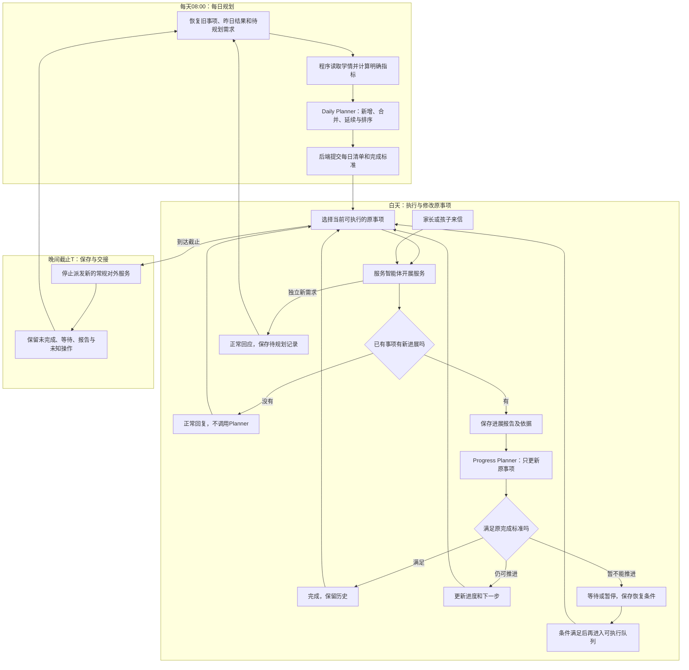

# 教辅数字员工智能体后端开发方案

版本：简化版V1 · 2026年10月3日（Asia/Shanghai）。状态：按用户最新讨论重写，新增后端尚未实现。

**每天08:00统一规划；白天只执行和更新已有事项。** 本文与运行、上下文、工程四份主文档是当前开发依据。此前“回复前先协调规划”的复杂版已被取代，完整保留在[历史归档](history/2026-10-03-before-v1/教辅数字员工智能体后端开发方案.md)。

## 1. 第一版边界

先跑通单家庭服务。学情基本每日更新一次，明确指标由程序计算。默认常规对外窗口为北京时间08:00至21:00，21:00起主动联系与普通答复统一截止，时间作为配置维护。08:00同时为每日规划时间，不等于可以立即联系所有家庭；主动联系另受家庭偏好和具体步骤约束。

Planner只有两个逻辑入口：

- **daily**：每天08:00新增必要事项、合并同目标旧事项、延续未完成工作，生成当天清单。
- **progress**：服务智能体提交事项新进展后，更新原事项的状态、下一步、等待或完成。

白天不新增正式事项；普通对话直接服务，不先等Planner。定时器、回执、学情同步和日终扫描不是第三个规划入口。失败重试和恢复沿用原任务身份。

## 2. 角色与权责

| 角色 | 负责什么 | 主要输出 |
| --- | --- | --- |
| 服务智能体 | 回答来信、执行原事项、调用服务Skill、报告进展和新需求 | 回复、实际动作、ServiceProgressReport、待规划记录 |
| Planner | 08:00安排事项；白天据报告判定原事项继续、等待或完成 | 每日规划提议或原事项更新提议 |
| 运行后端 | 规则计算、持久化、队列、上下文、校验、发送与回执 | 有效状态、执行资格和可查询历史 |
| 真人老师/运营 | 处理实际已接入的人工工作 | 接单和真实结果，不能由模型提议替代 |

两种模型职责隔离提示词、上下文和工具，经业务记录协作，不直接互相聊天。服务可以建议完成，Planner按原标准判断，后端核实依据后保存。

## 3. 事项和队列

| 对象 | 含义 |
| --- | --- |
| Event／持续事项 | 稳定目标，跨日沿用ID，保存完成标准、进展、下一步、等待及期限 |
| DailyPlan／每日清单 | 08:00形成的事项引用与安排；白天固定正式事项范围，只更新原条目 |
| 可执行队列 | 按当前条件派生；等待、暂停、完成或待更新事项不占执行位置 |
| ServiceProgressReport | 对原事项的新事实、家长反馈、实际操作和剩余工作的报告 |
| 待规划记录 | 当天独立的新后续需求，次日08:00决定是否新增、合并或不采用 |

**未完成清单与可执行队列分开。** 生病时补课目标保留，暂停催促、等待恢复，不持续重试或每天新建同一事项。

| 类型 | 建立时明确的完成标准 | 示例 |
| --- | --- | --- |
| 发送型 | 指定内容、对象和要求版本达到已确认的交付阶段 | 文字反馈实际发送成功，可以完成该交付事项 |
| 目标型 | 明确业务目标经适用证据满足 | 原课节补课完成；发过提醒只是进展 |

不能把“完成补课”降为“发过提醒”来结案。文字、图卡等必要组成在原事项内分别记账；一部分交付不代表全部完成。草稿、提交成功、送达未知不能混为实际交付。

## 4. 从08:00到服务截止

### 4.1 每日规划

08:00读取全部未完成事项、未消费进展、待规划记录、周期职责、最新可用学情及覆盖时间、约束和家庭偏好。程序算事实，Planner做取舍，后端校验提交。合并只针对同目标，保留原ID关联、承诺和操作历史。

提交后固定当天正式事项范围；完成条目保留历史，等待项退出执行队列。长期事项今天不执行，也不从责任目录中消失。重启恢复原daily任务，不重新新增。

### 4.2 对话与进展更新

服务正常理解和回复，明确暂停经后端校验立即生效。普通对话不默认经过“理解→等Planner→最终回复”。相关进展提交后只暂缓原事项重复派发，其他服务继续。

可以先关心生病、答入口或澄清；要声称“已完成”“新期限已生效”必须有实际依据和提交结果。更新结果进入原Event和计划条目，下一次服务读取，不向当前对话注入Planner内部推理。

### 4.3 当天新需求

当次可完成的临时问题正常处理。需要后续工作且不属于原事项的，保存来源、提出时间、用户原期限、已做部分和剩余需求，明早统一评估。不得通过修改旧目标偷偷新增独立服务。

待规划不等于完成或承诺明天交付，不覆盖用户原期限。必要即时人工受理沿用已有服务能力，不扩大Planner入口。

### 4.4 日终

截止前程序扫描临近承诺；服务发现履约困难仍报告原事项。到T停止常规新外发，后台继续接收消息和回执、保存原报告的处理结果。日终不无条件调用Planner。

未答消息、未消费报告、等待事项、待规划记录与未知操作跨日保留；原期限、暂停和身份不随日期重置。

## 5. 保留与延后

| 保留 | 首版不采用／延后 |
| --- | --- |
| 两个隔离角色、确定性规则、持久记录、发送前校验 | 多事件直接触发局部Planner、每次回复等待规划 |
| 进展报告、完成标准、跨日等待和恢复 | 白天新增正式事项、跨事项自动合并或整体重排 |
| 当前Event目标、约束、方法建议进入服务上下文 | 通用Decision依赖图、复杂原子组、强制ServiceBrief层 |
| 暂停即时生效、原回执核实、部分交付 | 用草稿或模型“已完成”替代真实结果 |
| 有效改约依据、原期限与历史 | 通用协商引擎；简单变更可嵌入原事项 |

R05家庭成员修改权限细分继续暂缓；R10高频无关更新优化延后。家庭范围隔离、来源和暂停仍适用。

## 6. Skills、知识与个性化

| 能力 | 角色与入口示例 |
| --- | --- |
| 运营规划 | Planner：plan-proactive-service，待适配daily/progress范围 |
| 答疑与分享 | 服务：explain-lesson、answer-course-service-question、respond-to-child-sharing-help |
| 督学补课 | 服务：remind-reading、prompt-backlog-makeup、plan-makeup-learning、plan-weekend-makeup、rebuild-reading-rhythm |
| 阅读互动 | 服务：share-reading-reflection、quiz-course-knowledge、practice-reading-method、connect-reading-to-life |
| 成长反馈 | 服务：weekly-learning-review、review-learning-progress、highlight-expressive-answer、prepare-growth-review-package |
| 核实与人工 | 服务：address-learning-concern、handle-complaint-escalation、follow-up-unanswered-question |
| 收尾 | close-service-case整理真实结果，不自动结案 |

家庭补课Skill中的plan是具体服务方法，不是后台新增规划入口。完整加载选定Skill及必读规范；先接答疑、补课和反馈，不一次启用全部自动能力。

家庭偏好、关注、作品和支持方法进入适用上下文。一次表现不变成稳定能力，摘要不增加独立证据。暂停、期限和未完成责任确定查询，不靠向量检索命中。

## 7. 开发顺序与入口

1. 对齐用户提示词初稿、uid学情样本及实际接口。
2. 实现Event、DailyPlan、进展、待规划、操作记录和基本状态校验。
3. 实现08:00规划、报告更新和持久调度，验证白天不能新增。
4. 接入服务角色、Skills、知识与个性化，跑通补课和发送型反馈跨日服务。
5. 验证暂停、重启、未知发送、部分交付和更正，再接受控真实渠道。

首版采用单个Python业务应用＋SQLite，由后端管理状态、调度、提交与发送，经适配器连接现有Hermes/OpenViking；Hermes承载两个隔离模型角色。该运行方向已获用户接受，具体适配能力待验证，不先拆微服务或升级框架。

用户提示词初稿和data/表格数据.xlsx已接收，完成原稿保存、样本核对与映射草案；尚缺课程绑定、覆盖时间等信息。微信沟通先用明确标注的模拟数据，见[输入对齐](教辅输入对齐与学情映射.md)。

- [运行机制](规划与执行运行机制设计.md)：触发、报告、状态和跨日。
- [上下文设计](双智能体上下文组装设计.md)：三个配方与角色隔离。
- [工程与验收](智能体后端工程与验收设计.md)：最小接口和原34项验收的V1范围。
- [实施细化](教辅后端实施细化草案.md)：已接受的运行架构与端到端链路，适配能力仍待验证。
- [数据与接口合同](教辅后端数据与接口合同.md)、[开发任务清单](教辅后端开发任务清单.md)：新增字段、状态迁移、接口和实施拆分草案。
- [评审记录](智能体方案多智能体评审记录.md)、[业务原稿](教辅数字员工服务状态与规划设计交接.md)、[Skills交接](服务Skills开发总结与后续会话交接.md)。

本次只改设计，未实现后端、修改现有Skills/规则或用户提示词，未同步远端或触达家庭。此前复杂版HTML与模型模拟是历史证据，不是V1验收。
