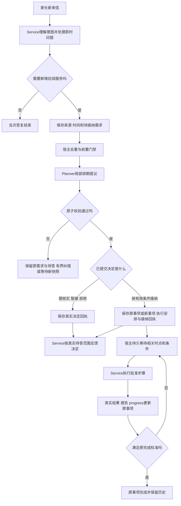

# 日内承接与按时执行设计

> 2026-10-05执行补记：用户接受模型处理导致的稍晚发送，当前连续时钟实测16:01:55.146530派发，比16:00晚115.146530秒，记录为已知表现，不作为本轮阻断项。`execute_at`表示到时可启动处理；明确的before/window截止与北京时间21:00仍是硬门禁。实际实现与本版验证见[实施记录](第四阶段日内承接与完成条件实施记录.md)。

2026-10-05 · V0.2。用户已批准按本工作流开发，并新增“完成条件可空，空时由 Service 自主判断”。隔离 L 正在实现和服务器验证，当前状态见[实施记录](第四阶段日内承接与完成条件实施记录.md)。本文第7节中的旧源码现状保留为设计时基线，不代表 L 仍未实现。未通过的历史关口不随设计修改而改判。

本文修订的是旧方案“只能在每日一次提交时新增事项和确定当天主动成员”的能力边界。其余已批准约束继续有效：两个角色、三个配方、单一持久任务队列、家庭串行、真实证据、被动模式门禁、08:00≤北京时间<21:00常规外发、mock家庭与渠道、Flash及材料授权范围。

## 1. 分工和上下文

| 角色/宿主 | 负责 | 边界 |
| --- | --- | --- |
| Planner | 结合责任、家庭约束与时间安排，接纳/暂缓/拒绝新需求，更新原事项下一步 | 只提交内部业务安排，不能发消息；模型提议须经宿主原子校验才生效 |
| Service | 理解来信、即时答疑、记录新需求，执行批准步骤，核实事实并报告 | 不自行新增未来承诺、改变完成标准或排整个家庭的日程 |
| 现有业务后端 | 保存安排，确定到期资格、版本、去重、取消、租约、发送与回执 | 不能替模型完成待测规划和进展判断，也不增加通用工作流引擎 |

普通问题继续由 Service 直接回答，新增 Planner 调用为0。需要新增未来服务、涉及原事项进展或改约时才进入相应规划路径；不把每次读知识库、写记忆都变成 Planner 任务。

实施中将同次来信解释的意图区分为默认`reply`和`future_delivery`。后者同时保存真实原话中的授权片段；宿主只允许这个原意图登记未来文字交付。问题暂时缺资料属于原答疑等待，不能仅因“需以后查清”就转成新安排。字段及片段一致性是程序门禁，分类是否忠实仍由独立语义复核；不另启一次分类模型。

Service 上下文改为按本次任务投影：当前来信、相关原事项、完整目标与完成标准、已完成/剩余部分、必要时间约束、暂停、未知操作、证据、批准知识和 Skill。保留定位旧事项所需的简要责任索引和受限补读入口。关联和技术引用可在工具字段中使用，但不能自动拼接进外发正文。

不装入 Planner 的 deliberation、未采用候选、内部排序理由、整个规划载荷或无关事项。Service 的 context.read 及其他查询工具也遵守同一字段/范围投影，不能只裁剪初始提示词却允许工具读回所有内部内容。该投影直接从已提交记录生成，不强制新增一份可失同步的独立 ServiceBrief。

隔离能减少暴露面，不能独自保证自然语言永不泄露。必须同时分开内部结果、运行诊断与真正的发送正文；程序验证权限和明显结构性越界，独立语义评审检查回答是否暴露无关后台信息。不能为了隐藏后台而去掉 Service 核实交付必需的证据和完成标准。

## 2. 一份持续安排，一个实际执行队列

完成条件分两层：原 `completion` 保存课节完成或必需交付件、回执阶段；新增可选自然语言 `completion_condition` 描述事项或动作的具体满足标准。来源提供时，新事项保存原说明；动作条件放在 `next_action.completion_condition`，仅评价该动作。省略、null、空串和空白视为未配置，由 Service 依据原请求、资料和实际结果自主判断，不要求家长补填占位说明。

Service 在 `completion_assessments` 报告实际采用的条件、是否满足、理由和真实证据；Planner 沿报告提交原事项状态。自然说明为空仍可完成，但目标型补课依然需要原课节可信完成事实，文字交付依然需要实际回执。提醒完成不能替代补课完成，草稿不能替代发送。后补动作说明只用于后续安排，不追溯覆盖已承接事项的旧标准；同目标沿用不会用新空值清掉原说明。

Planner 维护家庭业务事项及各事项的当前下一步，形成按时间查看的持续安排。它是业务状态的视图，包含等待、未来和当前可执行事项。实际的运行任务仍由现有 JobQueue 领取；不额外建一套独立排队引擎，也不以模型 TODO 代替业务记录。

时间至少区分以下含义，具体字段名待接口冻结：

| 含义 | 例子 | 工程约束 |
| --- | --- | --- |
| 家长原始时间要求 | “明天下午四点前” | 保存原话、日期、时段/精度与来源；不能悄悄改成更晚或更精确 |
| 下一步安排的执行时间/可执行区间 | 明天15:30开始生成并发送总结 | 宿主在到时后且资格满足才领取；不与截止时间混用 |
| 整个责任的截止 | 明天16:00前送达文字总结 | 用于接纳可行性、迟延检测；到点不自动完成、不自动取消 |
| 内部复核时间 | 明天14:00检查原资料是否补齐 | 只触发核实，不自动授权联系 |

“四点前”允许 Planner 根据真实要求提前安排，“四点给我”不能擅自提前外发。需要准备时间的任务可以安排更早的内部准备，正文发送仍按原约定；不承诺精确时刻必达或假定模型耗时为零。

实现中的`at`保留准确执行时点，`end`省略；若模型重复填同一时点，仅归一这个冗余字段，不把它解释为零宽度交付期限。不同的end须明确为真实区间或截止，不能混写。`before/window`保持原上界，已有事项due_at仍独立收紧执行窗口。没有另给截止的at安排在该时点后仍需满足同日21:00之前的常规外发窗口，运行记录如实保留实际发起时间，不能把晚到称为精确准点兑现。

领取步骤的顺序：先过滤已取消/被替代/未来/暂停/资料缺失/待报告更新/未知发送冲突等不可执行项，再在可执行项中按安排时间排序，同时间参考截止紧迫性、Planner有效顺序和稳定标识。现有来信优先、家庭串行以及安全核实仍需保留；持续来信造成承诺饥饿要显式检测，不能绕过发送门禁追赶时间。

等待中的队首不阻塞后面的可执行事项。一次执行结束即释放家庭租约；不同家庭按现有Worker容量推进。家庭级触达限制统一计算，不能每个事项单独重置额度。新插入需求不得无声挤掉已承接约定；冲突时保持未接纳、核实或提出改约。

业务执行时间用可注入业务时钟；租约与技术退避用既有运行时钟，不能直接把当前依赖 lease_clock 的 job.not_before 当成业务排期字段。实际发送进程仍检查同一可信业务钟与窗口。

## 3. 保留三配方，调整 daily 的触发与提交范围

| 配方 | 触发及范围 | 允许提交 |
| --- | --- | --- |
| service | 有效来信、批准步骤、相关来源核实 | 回答/执行、来源解释、待规划需求、原事项报告 |
| planner_daily：每日基线 | 每天一次，对完整责任目录做规划 | 新增/沿用事项、当天常规主动安排；必须保留已承接承诺 |
| planner_daily：日内接纳 | 已解释并持久保存的新需求，宿主绑定来源和候选 | 受限接纳、关联原事项或保留/拒绝；仅修改关联安排，不整体重排 |
| planner_progress | 指定报告及版本 | 更新报告绑定原事项、下一步时间/等待/完成；不独立新建目标或扩大联系范围 |

前两种规划触发共用 planner_daily 配方和角色，不新建第四种配方。触发原因和允许修改集合由宿主设置，模型不能自行把 progress 升格为日内接纳。

每日保持一份日期容器、一次成功的全量基线规划；日内接纳是版本化增量，不是再次生成全量 daily。如果当天基线尚未成功，接纳可先形成安排，容器存在不等于基线已完成；后续基线不得覆盖或删除已接纳责任。跨天的已批准安排先持久绑定原事项和目标日期，不依赖未来日期的基线模型再次选中。

保守沿用未消费报告的规划前置门禁，同时作用于基线与日内接纳：已有报告先沿原路径消费，已知门禁在模型运行前拦截。此选择会影响接单时延；长期失败需要可见原因、有界修复和仍未履行的责任，不能反复调用 Planner 碰门禁。已经生效且与报告无关的约定不因新的接纳被阻塞而丢失。以后如需缩小门禁范围，单独给出依赖与并发证明。

## 4. 新需求的完整链路

“登记”“正式接纳”“对外确认”“实际交付”分别记账。接纳以原子提交成功为准，必须存在明确对象、完成标准、来源、合理排期或明确等待责任及恢复条件；缺少必要资料不能声称已经安排好交付。涉及时间条件未定时，接纳哪一层责任必须明确，不能把‘愿意协助核实’说成接受最终交付期限。

按原请求条件接纳，与提出替代条件分开。Planner若修改家长指定的时间、对象或交付范围，只能先保存待接受提议，由Service取得有效接受依据后生效；不能先排成可执行，再用单向通知代替家庭同意。校验/技术失败不构成正式拒绝或暂缓决定，不能把失败提议当作已生效安排通知。

家长真正要求的“是否接受/怎样安排”决定可以保留为有界待答意图。Service登记后等待指定规划结果再接续，不反复回答“待安排”。若已先答同条消息的课程问题，只结清该答疑意图，不能整条误结清；也不能为了以后发消息而人为保留无关旧意图。原意图已经得到终局答复时，不自动借旧reply_to再发接纳确认。后续实际交付凭正式事项授权发送。

已实际进入planning_requested且await_decision的同源意图，准备和派发均禁止登记回复提前resolves_intent=true，允许真实partial回执。正式决定后，goal的安排确认可结清该消息，原学习目标仍由Event承担；正式接纳的delivery仍需实际交付才结清履行责任。拒绝/保留等已生效决定可按真实待答范围回复。普通缺资料记录不带规划责任，不被此门禁扩大限制；历史已终局结清的消息也不自动重开。

对于已经正式承接的文字delivery，原请求中待履行部分由原Event承担。宿主依据当前决定及真实partial确认回执标记责任交接；即使安排确认未实际发出，只要原步骤已凭有效资格真实发起必需交付件，交付也由原步骤持有。后者不标记安排已通知，更不标记完成；prepared/queued/failed不算真实开始。旧消息不再因无关版本变化领取同一交付；原意图仍可读、requires_reply保持，完成引用暂为空。待原Event通过全部交付件回执、Service判断及progress核验实际完成，原事务才将真实交付操作引用归还原请求并记录`delegated_completion`。确认不是完成，不追改普通reply为交付，不另发同义通知。未知确认和未知交付分别保留，不借另一回执结清。

宿主必须区分未解释的新输入与已经解释、等待接纳决定的输入：前者让行；后者是本次规划的合法来源，不能既让Service空转，又用‘仍未答’拦住Planner造成死锁。规划完成只唤醒对应决定的接续，接纳结果通知失败沿原操作/原意图恢复，不重新接单。

接纳确认发送失败或unknown不抹掉已承接责任，也不证明家长已看到确认。完全符合原家庭请求、原请求本身已明确授权的安排，可按原授权执行后续服务；需要接受替代条件的安排必须等有效接受，不能执行。确认与内容交付各自核原operation和覆盖范围，不能用交付回执自动清掉未确认责任；unknown核实仅阻断相关不确定副作用，不一概冻结无关事项。

新需求去重基于可信来源、目标范围和原事项关联；同目标尽量沿用原ID。原事项改约经service报告→progress，修改的是原下一步/有效约定；实际改变承诺要保留来源和历史。把未进入当前联系范围的旧事项加入安排，仍须由受限接纳明确授权，不能让progress顺手加成员。

## 5. 变更、跨天和过期

日内接纳原子核对来源/候选、家庭与相关事项版本、当前安排版本；保存接纳决定、事项/步骤、执行范围和提交回执。相同请求重试返回原结果；冲突读新快照，不能以旧载荷覆盖新安排。

未执行步骤被改约时，替换旧步骤版本并令旧任务/旧capability失效。已发起或结果未知的操作先沿原operation核实；插入新事项不能撤回已发消息，也不能生成新operation冒充重试。新来信时按现有让行流程撤权并安全释放，同家庭不重叠运行两个可写Agent。

已接纳的未来约定跨天保留。到目标日期，宿主从原已批准安排派生当日执行资格，仍核对暂停、最新来信、相关报告、原操作、材料、频控和窗口；不依赖当日baseline再次批准，不机械复制昨日主动名单。普通日批主动建议仍只在原批准日期有效，不能借此变成无限期联系许可。宿主投影已有约定不新增目标，也不重新决策是否接受。

持久承接资格须绑定可核的授权来源类型、原提交回执、事项要求/步骤/排期修订及目标日期或有界区间。普通baseline/progress仅写入未来执行时间，不能自动获得这类资格；progress仅可在既有承接范围内调整下一步，超出原联系日期/动作范围须走受限接纳或有据的原事项改约。持久保存的是业务授权，运行时每次仍新签租约与capability，不跨天复用旧令牌。

稳定执行身份绑定原事项、步骤身份及其业务修订，不因换日生成另一次发送。等待、报告、未答和未知操作保持原身份恢复。超出已约定时间时记录迟延并触发受限复核，保留原截止；不能默默移动时间、标完成或在21:00后补发。Planner可提出调整，需要家庭确认的承诺变更通过Service按有效权限沟通。

## 6. 示例

上午已有A补课提醒14:00、B文字反馈16:00。家长10:00提出“今天15:00给我新增发一份总结”：

1. Service保存真实需求；当条消息中能直接解答的问题立即解答。
2. Planner只处理新需求及相关冲突。资料、完成要求、联系限制与时段可行时，提交C的正式安排；不能把B改到明天而不说明。
3. Service依据已生效决定确认。时间视图为A 14:00、C 15:00、B 16:00。
4. 到14:00，A若暂停则保持等待，C/B按各自条件继续，不被A卡住。
5. C实际交付形成回执和报告，progress核对完成标准。A提醒成功不代表学习完成。
6. 若C在14:50收到改约请求，先阻止冲突的旧外发；有效改约确认并提交后，旧15:00步骤正式失效，保留原约定历史。若旧发送已经发起，先核实原操作，不能直接重发。

## 7. 当前源码证据与落地顺序

当前证据：`domain.py`的Step只有动作、对象和目的，Event.due_at是期限；`scheduler.py`会直接为有效next_action产生带业务日的step任务；`jobs.py`按任务kind排序，plan.rank尚未参与领取，not_before用租约时钟；`planning.py`对已存在当日plan拒绝新的daily提交；`context.py`对Service目标事项返回原记录并提供较宽责任摘要。故本方案需工程接线，不能仅改提示词就称按时执行或上下文隔离完成。

按职责分步实施，具体程序和模型验收继续使用第四阶段主方案的证据、重复与评分要求，不另建一套门槛：

1. 先冻结接纳与时间合同，并连同已定位的缺next_action、报告缺省值、回执派生版本冲突一起修复。
2. 接入每日基线/日内增量、受限候选与原子安排；保持旧报告真实消费和原ID去重。
3. 收窄Service上下文及工具返回；执行时间和稳定步骤身份接入现有Scheduler/JobQueue/发送门禁。
4. 用隔离服务器程序验证日内插入、未来不早发、同刻排序、等待不阻塞、改约旧能力失效、接纳决定无死锁、报告阻塞零模型、跨日既有承诺仍可履约、未知发送不重发、实际子进程21点边界。
5. 在授权mock/Flash材料范围内验证新接单和原事项全链，分别完成工程与业务评审；旧K证据不自动转为新版本通过。日内规划纳入修订后的4C，持续执行仍在4D验收，4E继续要求冻结版本两日完整链。

本轮评审文件：`work/stage4/intraday-design-20261005/engineering-review.md`、`business-review.md`、`runtime-review.md`。本文提出的提交分支和字段均不是现有Tool已支持能力，Tool/Skill目录仅记录待适配状态，正式材料未因设计变更获准进入模型。
