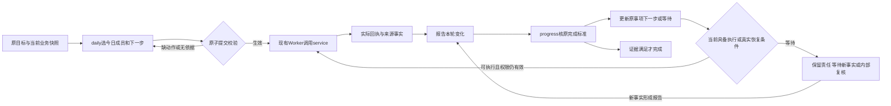

# 第四阶段计划与进展合同问题排查及原生Plan机制借鉴

2026-10-05。只读排查与解决方案，尚未实施修复。依据隔离K源码、原模型工具参数、业务/渠道证据、独立副本复现，以及Codex官方文档和服务器Hermes锁定版本。未修改业务源码、提示词、vendor或原验收数据，未调用真实模型；历史K结论不改判。

## 结论

两个问题主要落在业务工具合同：今日清单提交未验证执行入口，报告Schema把未提供误表达为空。可以补现有业务工程，不需要重写Hermes harness。今日事项适合作为智能体的有序计划，但必须同时保留原目标、下一步、等待条件及实际完成证据。

额外隔离复现发现：原报告引用消息v2，发送回执后消息更新v3，progress会被证据版本过期拦截。这项需一起处理，否则只补字段仍接不通后续链。当前没有发生误结案。

## 1. 今日成员没有下一步

**实际原因。** inbound_interleave恢复后的成功daily调用本来就省略了next_action；并非取消过程把已提交步骤删掉。create_and_reuse次日将原本无动作的历史事项选入今日，event_updates为空，也没有补步骤。

代码链：`domain.py:97`的EventCreate.next_action默认None，适用于未选中责任；`planning.py:113`对plan_refs只拒绝done/cancelled，没有检查入选后有效Event是否有动作或等待；`scheduler.py:42`仅对有next_action的pending/in_progress生成step。成功提交一日唯一计划后，不会再自动daily给该事项补步骤。

因此，提示词虽已要求为今日成员确定next_action，工具仍允许不完整计划入库。原程序用例主要断言新建/去重/今日成员/让行/提交，未断言每个成员的执行入口，是程序绿色但独立评审发现缺口的原因。

**建议最小修复。** 保留Plan.items的event_id和rank，保留Event作为唯一责任状态。在同一个daily事务内，先应用新事项和旧事项更新，再检查每个最终入选成员：

| 有效事项状态 | 提交要求 |
| --- | --- |
| pending / in_progress | 有合法next_action，动作目标在原完成范围内 |
| waiting | 有明确reason与resume_condition；review_at仍可空，按已有等待合同恢复，不自动解除暂停 |
| done / cancelled | 不纳入新今日主动清单 |

缺失时返回具体event/client_ref和原因，整次事务回滚，daily不占成功名额；由原生工具循环修正后重提。不让宿主替模型硬填“发提醒”或“发反馈”。未选中的历史责任仍允许没有next_action，不能把所有Event一律改为必填。progress更新今日原成员时同样检查更新后的状态，避免清动作或恢复pending后再次断链；不新增今日成员、不整体重排。

无需提前写死全天所有步骤。模型先确定一个有依据的下一步，例如核实学情；service取得新结果后报告，progress再决定继续、等待或完成。具体方法和措辞留给Skill，边界和状态一致性由后端保证。

细证据及调度复现见[独立根因报告](../work/stage4/plan-research-20261005/daily-root-cause.md)。

## 2. 报告文字未完成，remaining_work却为空

**对前次评审表述的纠正。** K report_gate的真实progress.submit参数没有remaining_work；模型facts、suggested_update和对外回复均明确只读一小段、尚未完成。`domain.py:185`使用default_factory=list，`application.py:209`的model_dump把省略转为[]并持久化。不是夹具替模型编报告，也不是模型主动作出了“没有剩余”的判断。

目前`commit_progress`不会把这个数组复制到Event；Change也不允许直接修改remaining_work。进入done仍须通过completion_met对原目标/回执的校验。原K报告未消费、原事项仍pending并保留Day1。新隔离复现中，无证据结案被COMPLETION_NOT_MET拒绝，以当前引用隔离空值问题的合成双事项复现中，合法不改变事项的报告消费保留原剩余；原K副本的消费另被下节的版本问题拦截。所以这里已证实的是语义混淆和后续误读风险，不能写成已经误结案。

**建议最小修复。**

1. 新报告明确区分“未评估/未提供”与“已评估为空”。报告中的remaining是本轮观察/建议，不能自动覆盖原事项义务。采用显式版本的输入合同；未知用null或明确评估状态表示，不能再缺省补[]。
2. progress上下文同时提供原Event完成标准及权威剩余、报告新事实及证据、报告是否明确作过剩余评估。完成只能经过原有可信证据/交付回执判定，不根据自然语言或数组为空结案。
3. 多事项报告按原设计的event_id、work_key、description表达观察，避免一份平铺列表含混地套给全部事项。优先落实已有接口合同，不另造第三种计划入口。
4. 历史报告与回执不改写。旧[]无法从存储值单独区分省略/明示，默认按未知处理；如需确认，可参考保留的真实原参数。历史同request/revision重试沿旧Schema/canonical规范化或在变更规范化前正确回放原回执，防止新null默认改变请求摘要；同身份载荷仍不可变。真正补充用连续修订，不删除报告来解除daily门禁。

## 3. 同链路发现的消息版本问题

原报告引用消息v2；回复送达后，原消息追加已答回执关联成为v3。现有validate_refs仅比较整条record.version，progress先被EVIDENCE_SUPERSEDED挡住。完整报告引用、原消息与实际内容差异见[报告根因及隔离复现](../work/stage4/plan-research-20261005/report-root-cause.md)。

建议把“原始消息事实是否更正”和“解释/已答回执等派生状态是否更新”分开验证，复用现有消息源内容指纹机制。采用专用report消息来源校验，要求宿主可信原始快照/读取证据与report、revision、ref精确关联，家庭与消息身份相同且原始内容/来源指纹确实未变；报告若依赖解释出的意图，还须核其相关语义未更正。仅有导出轨迹、当前摘要或正文相同不能自动认可旧来源；真实原文编辑、身份/时间/相关源内容变更必须拒绝并走受限报告修订。不全局放宽validate_refs，不能吞掉所有EVIDENCE_SUPERSEDED，更不能把旧ref直接换成最新版当作重新读过。

派生版本兼容也须覆盖报告生成时的快照，保持家庭版本/租约校验；这不是允许旧Planner继续使用过期执行能力。

## 4. Codex与Hermes的机制

| 机制 | Codex核验 | Hermes锁定版核验 | 本项目取法 |
| --- | --- | --- | --- |
| 计划模式 | /plan形成方案；模式与权限配置分开 | /plan给普通turn加计划指令，产出计划Markdown | 借鉴先澄清目标/范围/验证方法，勿把模式名当业务授权 |
| 执行清单 | update_plan步骤与状态；turn/plan/updated通知 | 原生todo_list，顺序、父子项、revision及合并 | 可用于复杂run内记事；业务状态继续由现有数据库管理 |
| 恢复 | 线程状态、最终item与工具结果分开 | TodoStore可通过历史/压缩快照恢复，但受版本和调用方式影响 | 从当前业务DB重建，不恢复旧快照的写能力 |
| 完成 | 持续Goal要求核证据，安全空闲边界续行 | todo completed是清单状态，不核本项目业务回执/学情 | 保留完成合同；发提醒、勾TODO、run结束均不等于补课完成 |

Codex依据本机CLI 0.144.0生成的协议及[官方Plan/TODO指南](https://developers.openai.com/cookbook/examples/gpt-5/codex_prompting_guide)、[App Server协议](https://learn.chatgpt.com/docs/app-server)、[Goal设计](https://developers.openai.com/cookbook/examples/codex/using_goals_in_codex)。公开协议把计划文本/进度与实际工具结果分开；TODO状态并不是外部业务完成证明。详细范围见[Codex调研](../work/stage4/plan-research-20261005/codex-research.md)。

Hermes服务器vendor为v0.21.5、commit f97608f178d1ffeca59860195ab7da295f7c8e5f。`agent/plan_prompt.py`明确以普通turn产生计划、无新增engine；`tools/todo_tool.py`维护运行内清单，并有压缩/历史恢复接线。当前digitalTutor只启用digital_tutor工具集，并精确校验实际工具集合，所以原生todo_list尚未开放。当前每run新进程且未传session_db/conversation_history，也未启用跨job原生todo恢复。详细源码、版本差异与官方链接见[Hermes调研](../work/stage4/plan-research-20261005/hermes-research.md)。

**当前修复不必先接入todo。** 这两类缺口即使加todo也仍存在。后续复杂service确有需要时，可在现有适配层开放原生todo，并补工具白名单/轨迹测试，限定为run内工作辅助；不写入第二套正式事项状态、不从completed同步结案。不自动升级vendor，也不引入第三方plan-mode插件。每日只有一次正式计划，progress只改原事项的合同保留。

## 5. 推荐实施顺序与验证

1. 先补选中成员的执行入口校验及原子回滚，修新/旧成员、让行重提、progress清动作/恢复状态几条边界。
2. 修报告省略/空值的表达，并处理历史报告读取和幂等；同时修消息派生版本导致的消费阻塞。
3. 在隔离新版本上验证完整daily→service→报告→progress→下一步/完成；继续用Flash和mock，不改原K证据。

必要测试不只断言字段：缺动作提议必须不写Event/Plan、不占当日名额，补正可提交一次；未选历史无动作合法；真实等待不催生模型重试；省略剩余不会显示为全部完成；空观察不能绕过可信完成证据；多事项各保各的义务；只有回执追加时旧原文证据可核实，真实源更正仍拒绝；中断后新快照合法、旧能力无效；原生todo若启用，勾完不改变任何业务责任。旧请求省略/明示空数组均按原幂等规则重放，同report/revision的新request不能改变原载荷。waiting恢复可执行状态按现合同使用in_progress；无review_at也保留责任，review到点仅核实，不自动解除等待或取得联系许可。

这份方案已区分技术链路和后续提示词打磨。当前先完成诊断与方案，尚未开始上述修复或新一轮模型验收。
