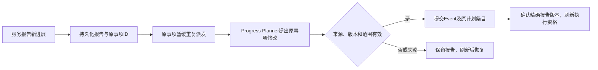

# 规划与执行运行机制设计

> 2026-10-05最新交付：隔离L已实现日内承接、按时间执行与可空完成条件；test15服务器532项程序通过，native06新状态10案/52 native/384 API全部Flash、程序10/10通过。独立工程、语义及未覆盖范围见[实施记录](第四阶段日内承接与完成条件实施记录.md)文末；4B/4C整体验收未签通过，本轮停在4C。下文H/J/K及较早L结论为历史证据，主目录与亲测数据未替换。

> 日内承接方向更新（2026-10-05）：用户已选择日内正式承接。后续机制采用[日内承接与按时执行设计](日内承接与按时执行设计.md)：planner_daily区分每日基线与受限日内接纳，progress仍只处理原报告事项；持久已承接步骤与普通当日主动资格区分，时间安排复用原JobQueue。以下V1及J/K段落保留为原合同/历史实现，新增设计尚未实现。

版本：简化版V1 · 2026年10月3日（Asia/Shanghai）。设计已重写，未实现。

**当前只有08:00每日规划和服务进展更新。** 旧第1—14节见[历史运行机制](history/2026-10-03-before-v1/规划与执行运行机制设计.md)，其多入口增量规划和回复前协调不再作为首版默认。

## 1. 两个Planner入口

| mode | 触发 | 可修改 | 不允许 |
| --- | --- | --- | --- |
| daily | 每天08:00持久任务 | 新增、同目标合并、延续/完成旧事项，形成DailyPlan | 重复建目标、丢弃原承诺与事实 |
| progress | 服务提交已有事项新进展 | 报告关联Event及原条目的状态、方法、下一步、等待、有效约定 | 新Event、新独立目标、白天跨事项合并或整体重排 |

mode及允许event_ids由后端绑定，不能只写在提示词里。发现独立新需求仅保存待规划记录。普通来信、回执、定时器、学情同步和日终扫描不是第三个入口。

失败重试和停机补跑沿用原业务日/报告身份。重复扫描、重复报告不重复调用模型，Planner提交不自触发。

## 2. 清单与资格

持续目录保留全部未完成Event；DailyPlan在08:00固定正式事项范围；执行队列按当前条件派生。等待、暂停、完成、已领取及update_pending项不重复派发。

完成条目保留历史。今天未选中推进的旧事项仍保留责任；白天可更新其进展，但不能自动加入当天主动范围。

Event状态：pending、in_progress、waiting、done、cancelled。update_pending为临时协调标记；暂停为独立、有范围的约束。取消需依据，不能隐藏未完成。

## 3. 完成标准

建立时保存completion_kind、completion_rule和目标范围：

- delivery：指定内容、对象和要求版本达到已确认交付阶段。
- goal：明确业务目标有据满足；发过提醒仅算过程。
- 文字/图卡等必要部分用delivery_parts分别记账。
- 草稿、请求受理、送达未知不算实际交付；送达不推导满意或掌握。

白天不能降低原完成标准或把新独立目标包装成修改。学习完成看可靠学情及覆盖范围；连续缺课由程序算，未知规则不由模型补定。

## 4. 08:00每日规划

1. 按家庭/服务日领取唯一daily任务，恢复未成功的同一运行。
2. 装入全部未完成事项、未消费报告、待规划记录、周期职责、最新可用学情及覆盖时间、约束和家庭偏好。
3. 程序计算指标和候选，不补造课表、请假或完成时间。
4. Planner判断旧事项继续/等待/完成、必要新事项、同目标合并与今日次序。
5. 后端校验并原子保存Event、DailyPlan、处理覆盖和等待条件；提交成功后才派发。

合并保留旧ID映射、真实交付和原期限，不合并不同完成标准。重复08:00唤醒或已成功计划的重启不重复新增。

每日一次数据不保证08:00到齐。使用最新可用数据并保留缺口；迟到批次不再次daily。新候选等次日，原事项在已有步骤核验时可形成进展报告。规划失败不把候选当有效计划，普通来信仍正常处理。

## 5. 服务与进展报告

### 5.1 服务流程

服务依据当前来信或原事项步骤正常答疑、支持与交付，不先等Planner。明确暂停经校验立即保存；多意图消息保留所有问题和变化，未理解的相关范围暂缓新的主动外发，必要时直接澄清。

有原事项新事实或实际结果才提交ServiceProgressReport；无变化不报空进展。可以先关心生病、回答入口；要声称改期/结案已生效，必须读取真实提交结果。

### 5.2 最小报告

| 字段 | 含义 |
| --- | --- |
| report_id、revision、event_ids | 稳定报告及已有事项范围 |
| source_refs、progress_facts | 原话、作品、学情、实际新情况与来源版本 |
| suggested_update | 建议继续、等待、下一步或完成，不是已生效事实 |
| remaining_work | 尚欠目标、交付、资料或确认 |
| operation_refs | 原操作及真实阶段，未知单独保留 |
| input_coverage | 本次已理解/已答及剩余消息范围 |

报告入库后原事项update_pending，避免重复派发；其他事项和对话继续。Planner核对原标准，不照单接受“服务声称完成”。

发送未知时不能报成功。后续回执补齐原服务动作，程序可补充原报告执行结果并恢复该报告的progress更新；这是服务报告延续，不允许任意回调另建规划。发生时间、回执确认时间与报告修订分别记录。

### 5.3 更新与提交

首版用单家庭短事务应用本次关联更新，无须通用Decision依赖图或复杂原子组调度。多个事项各自判断完成，一项交付不关闭另一项目标。

同一报告版本重复提交返回原回执，同身份不同载荷拒绝。旧解释被替代后不得重试恢复。失败、过期或无效输出保留报告和update_pending；有更新报告未处理时，旧报告完成不能解除该标记。模型和网络调用不占长事务。

## 6. 如何影响服务上下文

提交后修改Event和原DailyPlan条目，下一次服务读当前目标、状态、下一步、约束、完成标准及service_hint。service_hint可选，不设强制独立ServiceBrief层。

当前对话不普遍等待进展更新，不加载Planner内部推理或把候选提议当事实。需要确认某次改约/结案时才查询对应提交结果；尚未提交如实表达待确认。

## 7. 等待、改约与新需求

等待保存reason、resume_condition、可空review_at及时间来源。家长回复、原操作结果、下一批学情或内部复核可唤醒原步骤；无时间记录也进入每日恢复目录。唤醒不等于发送许可，不自动解除暂停。

“明晚看看”保存日期/时段精度，内部检查时间由配置另行确定，无变化核验不重复报告。

简单改约在Event内嵌proposed_change及生效依据。提出或送达“改到明晚可以吗”不替换原期限；有效接受经报告更新后，同步责任、DailyPlan和定时索引，保留旧期限/逾期历史。改约不自动解除暂停。

独立新需求存PendingPlanningInput：来源、内容、提出及要求时间、已做工作、未答/待跟进状态。次日daily关联、新增或不采用；当天不进主动队列。当次可完成的临时问题照常回答，不擅自承诺未排入的后续工作当天完成。

## 8. 发送与证据的基础检查

- 发送前检查服务窗口、暂停、相关新输入、事项状态、待更新标记、准确文案/目标和原操作。
- 文案不能夹带受限催课/邀请；提供动作与目标，实质修改后重新检查，不只看最初答疑标签。
- 在途操作保留事实，不假装撤回。未知先查原操作，单次not_found不足以安全重发。
- 原回执入账与当前完成判断分开。旧内容因实质更正失效时不能关闭新要求；纯期限变化不机械作废适用内容。
- 权威更正使旧执行资格失效并保留历史。原事项纠正经服务核验/进展报告更新，新目标留待次日daily。

首版保留保守版本检查，R10精细依赖优化延后。

## 9. 截止与恢复

常规对外窗口默认北京时间08:00至21:00，可配置；晚间截止T为21:00，主动联系与普通答复统一截止。08:00不自动授权主动联系，仍需检查家庭偏好与步骤窗口。截止前扫描临近承诺；新进展/履约困难由服务报告原事项，没有变化不做日终Planner。

T后停止常规新外发，已生成草稿真正发送前仍检查时钟。后台接收消息和回执、完成原报告内部更新，不据此继续常规对外服务。

保存未答消息、未处理报告、未完成Event、待规划记录、未知操作及记忆同步缺口。次日08:00恢复相同身份和原期限；跨日不结案，恢复不批量补发。

## 10. 例子与旧机制处置

| 情况 | 处理 |
| --- | --- |
| 08:00建立补课目标型E1与文字发送型E2 | 各自保存完成标准，进入当天清单 |
| 文字实际送达，服务报告E2 | progress核对依据后完成E2 |
| 家长说最近生病，服务报告E1 | 适用暂停立即保存，progress改等待，目标保留 |
| 同时问入口 | 直接答疑，不调用Planner或解除暂停 |
| 独立长期新需求 | 待规划记录，次日daily评估 |
| 晚间截止 | E1跨日保留，E2不再派发，未知操作继续核实 |

旧PlanningSignal多入口、通用DecisionPatch依赖、强制ServiceBrief、澄清票据编排不作为V1前置。来源、等待、暂停、有效改约和回执适用性原则保留。旧验收映射见[工程文档](智能体后端工程与验收设计.md)，历史模拟不证明本版实现。

## 隔离J实现合同补充（4C联合验证中，2026-10-04）

本轮保留Hermes原生循环、两角色三配方和现有家庭队列。候选、发送门禁、实际消息读取证明及来源恢复属于智能体外业务工程，未修改vendor。

strict daily在领取及装配前准备可信候选快照，完整恢复旧责任、pending、控制和缺口；事务中复核原来源并原子提交决定。`daily`运行模式允许规划当天成员，但禁止实际主动发送，不应因隔离模式自动给出空计划。已知未消费报告在模型前等待；新来信撤销旧Planner权限，先service，再从新快照恢复原daily。

未答资料恢复只观察原失败读取的批准材料。Worker先领取合法工作，仅空闲时做有界探测；来源未变不新建任务或唤醒自身。批准字节恢复后原Job接续，回执内部记账不得提前消费资料恢复资格。本轮只验证daily独立规划及报告门禁，报告消费/progress和主动执行属于4D。

实现位于隔离J，337项服务器程序检查通过；真实验证和双审进行中，主目录H与历史结论未替换。

### 隔离K实现与验收限制（2026-10-04）

候选/消息阅读门禁/材料恢复/控制范围/有限daily及安全导出已实现于隔离K，主目录仍为H。361项程序通过不等于语义验收；K实际发送仍有未安排回告承诺和方法来源错误，且恢复计划下一步、报告remaining_work存在欠项。正式Skill与批准材料字节不扩充、不把模拟规则当正式政策；本轮不新增Planner入口。详见[当前交付与待决项](第四阶段4C隔离K交付与待决记录.md)，4B/4C gate=false。
